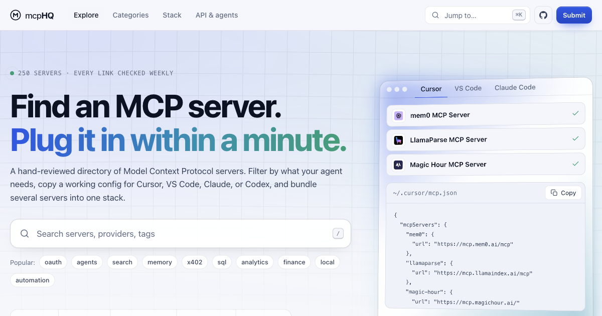

# Awesome MCP Servers

[](#catalog)
[](https://github.com/mcpHQ/awesome-mcp-servers/stargazers)
[](https://github.com/mcpHQ/awesome-mcp-servers/commits/main)
[](https://github.com/mcpHQ/awesome-mcp-servers/actions/workflows/link-check.yml)
[](https://modelcontextprotocol.io)
[](LICENSE)

**A hand-curated, link-checked catalog of [Model Context Protocol (MCP)](https://modelcontextprotocol.io) servers, with a [searchable directory](https://mcphq.org/) and a [JSON API](#use-the-data).**

<a href="https://mcphq.org/" target="_blank" rel="noopener noreferrer">
  
</a>

<p align="center"><b><a href="https://mcphq.org/">Open the mcpHQ directory →</a></b></p>

MCP is an open protocol that lets AI applications connect to external tools and data through a standardized client-server interface. This list focuses on well-scoped, source-available servers that extend AI workflows with databases, developer tools, browsers, cloud services, and more.

## Why this list

- **Curated, not scraped.** Every entry is reviewed against the [quality criteria](#quality-criteria). Spam, impersonators, and abandoned forks are rejected.
- **No dead links.** Every link is checked on each pull request and again every week. Broken entries get fixed or removed.
- **Structured data.** Every server has a category, language, provider, tags, and an official/community flag in [`data/servers.json`](data/servers.json). The README, [`llms.txt`](llms.txt), [`llms-full.txt`](llms-full.txt), and the website are generated from that file.
- **Ready to plug in.** Every server has its own page on the website. Hosted servers come with one-click install links and configs for Cursor, VS Code, Claude Code, Claude Desktop, and Codex, and you can merge several into one config with the stack builder.
- **Built to be reused.** You can pull the whole catalog as JSON into your own tools, agents, or dashboards.

If this list saves you time, please ⭐ star the repo. It helps other people find it.

## Quick Links

- [mcpHQ directory](https://mcphq.org/): search, filter, and install servers
- [Stack builder](https://mcphq.org/stack/): merge several servers into one client config
- [Use the data](#use-the-data): JSON API and LLM catalog files
- [LLM index](https://mcphq.org/llms.txt): short catalog index for agents
- [Listed on mcpHQ badge](#listed-on-mcphq-badge): for server maintainers
- [Official MCP Registry](https://registry.modelcontextprotocol.io/)
- [MCP Specification](https://modelcontextprotocol.io/specification/latest)
- [Reference Servers](https://github.com/modelcontextprotocol/servers)
- [Contributing Guide](CONTRIBUTING.md)

## Catalog

- [Official and Reference Servers](#official-and-reference) (11)
- [Databases and Storage](#databases-and-storage) (17)
- [Developer Tools and Code Intelligence](#developer-tools-and-code-intelligence) (57)
- [Browsers, Search, and Web Automation](#browsers-search-and-web-automation) (50)
- [Filesystems and Documents](#filesystems-and-documents) (18)
- [Cloud and Infrastructure](#cloud-and-infrastructure) (25)
- [Communication and Productivity](#communication-and-productivity) (57)
- [AI, Agents, and Memory](#ai-agents-and-memory) (58)
- [Data, Analytics, and BI](#data-analytics-and-bi) (50)
- [Legal and Court Data](#legal-and-court-data) (7)
- [Security and Identity](#security-and-identity) (26)
- [Finance, Commerce, and Business Apps](#finance-commerce-and-business-apps) (94)
- [Utilities and Examples](#utilities-and-examples) (20)

<a id="official-and-reference"></a>

## Official and Reference Servers

Reference implementations, SDKs, and core protocol tooling from the MCP ecosystem.

- **[MCP Everything](https://github.com/modelcontextprotocol/servers/tree/main/src/everything)** `Official` `TypeScript` — Reference server exposing prompts, resources, and tools for protocol testing.  
  `reference` `testing` `official`
- **[MCP Fetch](https://github.com/modelcontextprotocol/servers/tree/main/src/fetch)** `Official` `Python` — Fetch web content and convert HTML to markdown for LLM consumption.  
  `reference` `web` `official`
- **[MCP Filesystem](https://github.com/modelcontextprotocol/servers/tree/main/src/filesystem)** `Official` `TypeScript` — Secure local filesystem access with configurable allowed directories.  
  `reference` `filesystem` `official`
- **[MCP Git](https://github.com/modelcontextprotocol/servers/tree/main/src/git)** `Official` `Python` — Read, search, and manipulate Git repositories through MCP tools.  
  `reference` `git` `official`
- **[MCP Inspector](https://github.com/modelcontextprotocol/inspector)** `Official` `TypeScript` — Visual testing tool for debugging MCP server capabilities and messages.  
  `debugging` `testing` `official`
- **[MCP Memory](https://github.com/modelcontextprotocol/servers/tree/main/src/memory)** `Official` `TypeScript` — Knowledge graph memory for persistent entities and relationships.  
  `reference` `memory` `official`
- **[MCP Python SDK](https://github.com/modelcontextprotocol/python-sdk)** `Official` `Python` — Official Python SDK for building MCP servers and clients.  
  `sdk` `python` `official`
- **[MCP Registry](https://github.com/modelcontextprotocol/registry)** `Official` `Go` — Official MCP registry service and API for discovering publicly available MCP servers.  
  `registry` `discovery` `official`
- **[MCP Sequential Thinking](https://github.com/modelcontextprotocol/servers/tree/main/src/sequentialthinking)** `Official` `TypeScript` — Structured step-by-step reasoning tool for complex problem solving.  
  `reference` `reasoning` `official`
- **[MCP Time](https://github.com/modelcontextprotocol/servers/tree/main/src/time)** `Official` `Python` — Time and timezone conversion utilities for agents and assistants.  
  `reference` `time` `official`
- **[MCP TypeScript SDK](https://github.com/modelcontextprotocol/typescript-sdk)** `Official` `TypeScript` — Official TypeScript SDK for building MCP servers and clients.  
  `sdk` `typescript` `official`

<a id="databases-and-storage"></a>

## Databases and Storage

Query, manage, and explore databases, vector stores, and data warehouses.

- **[Chroma MCP Server](https://github.com/chroma-core/chroma-mcp)** `Official` `Python` — Vector search and embedding storage with Chroma collections.  
  `vector` `embeddings` `rag`
- **[DBHub](https://github.com/bytebase/dbhub)** `Official` `Go` — Universal database gateway supporting PostgreSQL, MySQL, SQL Server, SQLite, and MariaDB.  
  `sql` `postgres` `mysql`
- **[Elasticsearch MCP Server](https://github.com/elastic/mcp-server-elasticsearch)** `Official` `TypeScript` — Search and analyze data in Elasticsearch clusters via MCP.  
  `search` `analytics` `elastic`
- **[HutchDB MCP Server](https://github.com/ExpeditedProjects/hutchdb)** `Official` `TypeScript` — Shared database for teams and AI agents: store, query, and update structured records over MCP.  
  `database` `postgres` `structured-data` `collaboration`
- **[MongoDB MCP Server](https://github.com/mongodb-js/mongodb-mcp-server)** `Official` `TypeScript` — Query and manage MongoDB databases and collections from AI clients.  
  `mongodb` `nosql` `documents`
- **[MotherDuck MCP Server](https://github.com/motherduckdb/mcp-server-motherduck)** `Official` `Python` — Run analytical SQL queries against local DuckDB files and MotherDuck cloud databases.  
  `analytics` `sql` `olap`
- **[Neon MCP Server](https://github.com/neondatabase/mcp-server-neon)** `Official` `TypeScript` — Manage Neon Postgres databases, branches, and SQL queries via MCP.  
  `postgres` `serverless` `sql`
- **[pgwarden](https://github.com/B0yko/pgwarden)** `Python` — Self-hosted PostgreSQL MCP gateway with OIDC login, per-user database roles, read-only queries, human-approved writes, and audit logging.  
  `postgresql` `oidc` `access-control` `approvals` `audit`
- **[Pinecone MCP Server](https://github.com/pinecone-io/pinecone-mcp)** `Official` `TypeScript` — Manage Pinecone indexes and run semantic vector queries.  
  `vector` `search` `rag`
- **[PlanetScale MCP Server](https://planetscale.com/docs/connect/mcp)** `Official` `TypeScript` — Manage PlanetScale MySQL databases, branches, and schema changes.  
  `mysql` `serverless` `sql`
- **[Prisma MCP Server](https://www.prisma.io/docs/ai/tools/mcp-server)** `Official` `Other` — Manage Prisma Postgres databases, Prisma Compute deployments, and Object Storage from AI tools through a remote MCP server.  
  `postgres` `sql` `serverless` `remote`
- **[Qdrant MCP Server](https://github.com/qdrant/mcp-server-qdrant)** `Official` `Python` — Store and retrieve vectors in Qdrant for RAG workflows.  
  `vector` `search` `rag`
- **[Redis MCP Server](https://github.com/redis/mcp-redis)** `Official` `Python` — Read and write Redis keys, lists, and data structures through MCP.  
  `redis` `cache` `kv`
- **[RowSafe](https://github.com/rowsafe/rowsafe)** `Official` `Go` — Database health, backups, recovery and provisioning via local stdio or remote Streamable HTTP; requires a RowSafe account for the separate hosted service, with an Apache-2.0 agent, CLI and MCP server.  
  `postgresql` `backups` `migrations`
- **[Snowflake MCP Server](https://github.com/Snowflake-Labs/mcp)** `Official` `Python` — Query Snowflake warehouses and manage data platform resources.  
  `warehouse` `sql` `analytics`
- **[SQLite MCP Server](https://github.com/ktanaka101/mcp-server-duckdb)** `Python` — Lightweight SQLite database access for local development workflows.  
  `sqlite` `local` `sql`
- **[Supabase MCP Server](https://github.com/supabase-community/supabase-mcp)** `TypeScript` — Community-maintained integration for Supabase projects, tables, and auth through MCP tools.  
  `postgres` `backend` `sql`

<a id="developer-tools-and-code-intelligence"></a>

## Developer Tools and Code Intelligence

Repositories, CI/CD, observability, and coding workflows for software teams.

- **[Harness MCP Server](https://github.com/harness/mcp-server)** `Official` `TypeScript` — Official Harness.io MCP server for CI/CD pipelines, deployments, GitOps, and platform engineering workflows.  
  `harness` `cicd` `devops`
- **[Agent QA](https://github.com/vostride/agent-qa)** `TypeScript` — Run natural-language web and mobile regression tests with persistent test memory through CLI and MCP interfaces.  
  `testing` `regression` `browser` `mobile` `mcp`
- **[agent-chain-doctor](https://github.com/elfovo/agent-chain-doctor)** `Python` — Read-only diagnostic that inspects the scheduler config (launchd, cron, systemd) and trace files of a scheduled AI agent and reports which of 30 silent-failure modes it is exposed to.  
  `scheduled-agents` `diagnostics` `launchd` `cron` `claude-code`
- **[AgentSandboxes](https://agentsandboxes.fyi)** `TypeScript` — Search an index of cloud sandbox providers for AI agents: isolation, cold start, persistence, GPU support and pricing, each fact linked to its source.  
  `sandboxes` `agents` `developer-tools` `directory`
- **[AgentTask Atlas](https://agenttaskatlas.com/mcp)** `Official` `TypeScript` — Read-only, no-auth search over a curated catalog of MCP servers and Agent Skills organized by dev task, each with a one-line verdict, install command and source link.  
  `directory` `discovery` `devtools` `remote`
- **[API.market MCP Gateway](https://api.market/mcp)** `Official` `TypeScript` — Proprietary hosted OAuth gateway with five tools for API discovery, schemas, execution, usage and subscriptions; free tiers and paid plans vary by API.  
  `api` `gateway` `oauth` `hosted`
- **[Apple Docs 2.0 MCP](https://github.com/mishafyi/Apple-Docs-2.0-MCP)** `TypeScript` — Searches and reads Apple's developer documentation, Human Interface Guidelines and 1,700 WWDC sessions with code, with an offline index of 336,629 pages.  
  `apple` `ios` `swift` `documentation` `wwdc`
- **[AsItIs](https://github.com/Katta041/asitis-agent-tools)** `Official` `TypeScript` — Read-only server that lints CLAUDE.md, AGENTS.md and SKILL.md against vendor rules, estimates the tokens they load per session, and flags hidden instructions such as comments addressed to the AI and invisible Unicode.  
  `claude-md` `agents-md` `linting` `prompt-injection` `markdown`
- **[ax](https://github.com/Necmttn/ax)** `TypeScript` — Local-first MCP server for querying coding-agent sessions, tool calls, skills, and costs.  
  `observability` `coding-agents` `costs`
- **[Bestax](https://github.com/allxsmith/bestax/tree/main/bestax-mcp)** `Official` `TypeScript` — Build Bulma v1 React apps with Bestax using an offline index of its component props, examples, CSS variables and Agent Skills.  
  `bulma` `react` `typescript` `components` `local`
- **[Chain.Love MCP](https://github.com/Chain-Love/chain.love-mcp)** `Official` `Other` — Hosted MCP gateway for searching and comparing Web3 infrastructure services, such as RPC, indexing, and oracle providers, by blockchain network.  
  `web3` `infrastructure` `discovery` `remote`
- **[Communicate](https://developer.communicate.so/docs/mcp)** `Official` `TypeScript` — List workspace AI agents through a read-only hosted Streamable HTTP MCP server authenticated with OAuth client credentials.  
  `agents` `customer-support` `remote` `oauth`
- **[Concord MCP](https://github.com/Get-Concord-AI/concord-mcp)** `TypeScript` — Local-first shared work-state for coding agents with presence, claims, messaging, handoffs, and review packets.  
  `coding-agents` `coordination` `local-first`
- **[Constitution Lint MCP Server](https://github.com/joeyycli/constitution-lint-action)** `Python` — Lints CLAUDE.md-style AI agent constitution files for missing operational guardrails: spend limits, injection defense, escalation paths, and secrets handling.  
  `agents` `guardrails` `linting` `ci-cd` `safety`
- **[ContactLint](https://github.com/zksyncer/contactlint)** `Official` `TypeScript` — Validate email syntax, DNS/MX over DoH, disposable domains, role addresses and typos, plus E.164 phone numbers via HTTP API and remote MCP, with no SMTP probing.  
  `email-validation` `phone-validation` `data-validation` `crm` `remote`
- **[Context7 MCP](https://github.com/upstash/context7)** `Official` `TypeScript` — Up-to-date library and framework documentation injected into prompts.  
  `docs` `libraries` `coding`
- **[Docker MCP Server](https://github.com/docker/mcp-gateway)** `Official` `Go` — Manage containers, images, and Docker environments through MCP.  
  `containers` `devops` `docker`
- **[Docsy](https://github.com/getremcp/docsy-plugin)** `Official` `TypeScript` — Retrieve version-specific developer documentation and original source links through five read-only remote MCP tools.  
  `documentation` `developer-tools` `versions` `oauth` `remote`
- **[E2B MCP Server](https://docs.e2b.dev/mcp)** `Official` `Other` — Secure cloud sandboxes with a built-in MCP gateway for running code and MCP tools in agent workflows.  
  `sandbox` `code-execution` `agents`
- **[ERIUS PHONE MCP](https://github.com/Protremix/erius-phone-mcp)** `Official` `Python` — Drive an ERIUS PHONE hosted Android phone or tablet: read the screen, tap, type, swipe, launch apps, install APKs, and pull crash logs.  
  `android` `mobile` `testing` `automation`
- **[Flare](https://flareapp.io/docs/flare/general/our-mcp-server)** `Official` `PHP` — Investigate, resolve, snooze and assign errors, search logs, and find slow routes, queries and jobs in Flare, Spatie's error tracking and performance monitoring for Laravel and PHP.  
  `error-tracking` `observability` `laravel` `php` `oauth`
- **[GitHub MCP Server](https://github.com/github/github-mcp-server)** `Official` `Go` — Official GitHub integration for repos, issues, pull requests, and code search.  
  `github` `git` `ci-cd`
- **[GitLab MCP Server](https://docs.gitlab.com/user/gitlab_duo/model_context_protocol/mcp_server/)** `Official` `Ruby` — GitLab Duo MCP server for merge requests, issues, and project management.  
  `gitlab` `devops` `issues`
- **[GodotMCP](https://github.com/vberai/godot-mcp)** `GDScript` — A secure, 100% native GDScript Server-Sent Events (SSE) server bridging Claude, Cursor, and Windsurf directly to Godot 4.x scene trees. No Node.js or C# dependencies required.  
  `godot` `developer-tools` `code-intelligence` `claude` `cursor`
- **[installed-api](https://github.com/ajwann/installed-api)** `Python` — Answers API questions from the packages installed in the project: Python signatures, docstrings and source from the project's interpreter, TypeScript declarations from node_modules, and installed versions.  
  `python` `typescript` `api-docs` `claude-code`
- **[IntlPull MCP Server](https://intlpull.com/docs/mcp)** `Official` `TypeScript` — Manage translation keys, translate strings, and sync localization files with IntlPull from MCP clients.  
  `localization` `translation` `i18n` `developer-tools`
- **[ipvolt Proxy Toolkit](https://github.com/ipvolt/proxy-toolkit-mcp)** `Official` `TypeScript` — Search reviewed proxy guides, generate tested proxy configuration templates for curl, Requests, HTTPX and Playwright, and diagnose proxy errors such as a 407 on CONNECT or a TLS failure.  
  `proxy` `networking` `troubleshooting` `remote`
- **[Kleap](https://github.com/kleaphq/cli)** `Official` `JavaScript` — Create, edit, and publish websites from AI clients through a hosted MCP server.  
  `websites` `publishing` `cli` `agents`
- **[Kubernetes MCP Server](https://github.com/Flux159/mcp-server-kubernetes)** `TypeScript` — Operate Kubernetes clusters with kubectl-style MCP tools.  
  `kubernetes` `devops` `cloud`
- **[Latchkey](https://latchkey.dev/documentation/connect-your-ai-agent)** `Official` `Other` — Official hosted MCP server for Latchkey's self-healing GitHub Actions runners: failure bundles with root cause and logs, run status, workflow dispatch, and one-off commands on fresh ephemeral runners.  
  `ci-cd` `github-actions` `devops` `hosted` `remote`
- **[Linear MCP Server](https://linear.app/docs/mcp)** `Official` `TypeScript` — Create and manage Linear issues, projects, and team workflows.  
  `issues` `project-management` `product`
- **[LynxPrompt MCP Server](https://github.com/GeiserX/lynxprompt-mcp)** `Official` `Go` — Browse, search, create and update LynxPrompt AI configuration blueprints (AGENTS.md, CLAUDE.md) on lynxprompt.com or a self-hosted instance.  
  `agents-md` `prompts` `ai-rules`
- **[Mac MCP](https://github.com/bulutarkan/mac-mcp)** `Python` — Local-first macOS MCP server for controlling browser tabs, Mac apps, files and terminal.  
  `macos` `browser-automation` `desktop-automation` `agents` `local`
- **[MaxiBestOf](https://github.com/luminous8/maxibestof-mcp)** `Official` `Other` — Search website designs, UI sections, fonts, palettes, and design profiles. Requires MaxiBestOf Pro.  
  `design` `websites` `fonts` `remote` `oauth`
- **[MCP Production Kit](https://github.com/A7mdMe/mcp-production-kit)** `TypeScript` — Enterprise TypeScript starter kit for building production MCP servers with dual stdio/SSE transports, SSRF defense, memory store, and Docker support.  
  `boilerplate` `starter-kit` `docker` `security` `developer-tools`
- **[mcp-pool](https://github.com/yuzu-octopus/mcp-pool)** `TypeScript` — MCP Key Pool Proxy — pool multiple API keys across upstream MCP servers to distribute rate limits. One subprocess per pool, lazy failover, per-key cooldown.  
  `mcp` `proxy` `pool` `api-keys` `rate-limiting`
- **[NAIF Gravity](https://naifgravity.com)** `Official` `Other` — Hosted MCP diagnostics for API authentication, webhooks, and AI-agent integration failures, with bounded repair workflows based on sanitized evidence; free triage and optional paid repairs.  
  `diagnostics` `api` `auth` `webhooks` `remote`
- **[Nicelydone](https://github.com/nicelydoneapp/mcp)** `Official` `Other` — Search web app screens, UI elements, and user flows for design research. Requires Nicelydone Premium.  
  `design` `ui` `ux` `remote` `oauth`
- **[Oh My Android](https://github.com/ateymoori/oh-my-android)** `Swift` — Native macOS app with a built-in MCP server that lets AI agents see and drive the Android Emulator and adb devices: screenshots, UI tree in dp, taps, logcat, dark mode, font scale, and locale.  
  `android` `emulator` `mobile` `testing`
- **[Openhook](https://github.com/openhook-dev/openhook-inbox)** `Official` `Python` — Open-source webhook inbox for AI agents to capture callbacks, inspect payloads, and wait for events over MCP; hosted or self-hosted, with private per-inbox access tokens.  
  `webhooks` `testing` `callbacks` `agents`
- **[OverlayQA](https://github.com/OverlayQA/mcp)** `Official` `TypeScript` — Runs WCAG accessibility (axe-core), color-contrast and design-token audits on any public URL and files the findings as QA issues in OverlayQA.  
  `accessibility` `wcag` `design-qa` `qa` `issue-tracking`
- **[Postman MCP Server](https://github.com/postmanlabs/postman-mcp-server)** `Official` `TypeScript` — Explore and run Postman collections and API workflows from AI clients.  
  `api` `testing` `http`
- **[REA](https://github.com/morluto/rea)** `TypeScript` — Local CLI and MCP server for agent-assisted reverse engineering of native binaries, JavaScript/Electron apps, and .NET assemblies.  
  `reverse-engineering` `binary-analysis` `devtools`
- **[ReMCP](https://github.com/getremcp/remcp)** `Official` `TypeScript` — Securely access computers explicitly paired to your account through a hosted OAuth MCP connection, including state-changing file, terminal, browser, and desktop tools.  
  `computer-use` `desktop-automation` `terminal` `browser` `oauth`
- **[RoboParts](https://github.com/lm203688/roboparts)** `Official` `JavaScript` — Vendor-neutral robot hardware compatibility checker across 868 entities with three-state verdicts and ISO 9409-1 flange anchor.  
  `robotics` `hardware` `compatibility` `industrial` `iso-9409-1`
- **[SanctionsKit Developer MCP](https://www.sanctionskit.com/resources/mcp)** `Official` `Other` — Public SanctionsKit documentation, API schemas, and request validation, with authenticated synthetic sandbox tools for building sanctions screening integrations.  
  `api` `documentation` `sanctions` `sandbox`
- **[Semgrep MCP Server](https://github.com/semgrep/semgrep/tree/develop/cli/src/semgrep/mcp)** `Official` `Python` — Run static analysis and security scans on codebases via Semgrep.  
  `security` `sast` `code-quality`
- **[Sentry MCP Server](https://docs.sentry.io/product/sentry-mcp/)** `Official` `TypeScript` — Investigate errors, releases, and performance issues in Sentry.  
  `observability` `errors` `monitoring`
- **[SFXMint](https://github.com/flreey/sfxmint-mcp)** `Official` `TypeScript` — Find CC0 sound effects by event, set or description and retrieve audio URLs without a key; optional custom generation requires a key and paid pass or plan.  
  `audio` `sound-effects` `remote` `cc0`
- **[SheetsData](https://sheetsdata.com)** `Official` `Python` — Electronic component datasheets for AI agents: pinouts, specs, package info and design checks from manufacturer PDFs, with part search across JLCPCB, Mouser and DigiKey; hosted, OAuth or API key, paid per call.  
  `electronics` `datasheets` `hardware` `embedded` `remote`
- **[SkillDB](https://github.com/devchad-cmd/skilldb-sdk)** `Official` `TypeScript` — Search reusable AI agent skills through an installable TypeScript MCP server; full skill content requires a Pro or Studio account.  
  `agent-skills` `developer-tools` `search`
- **[Sourcegraph Cody MCP](https://sourcegraph.com/docs/api/mcp)** `Official` `TypeScript` — Code intelligence and search across large codebases with Cody.  
  `code-search` `ai` `enterprise`
- **[Spinnaker MCP Server](https://github.com/GeiserX/spinnaker-mcp)** `Go` — Read and operate a Spinnaker instance through its Gate API: 37 tools for applications, pipelines, executions, deployment strategies, and infrastructure, plus a read-only toolset.  
  `spinnaker` `continuous-delivery` `devops`
- **[Tavero](https://github.com/baccaraaa/tavero)** `TypeScript` — Scans a running React 19 app (Vite or Next.js) for UI drift in buttons, cards, colors, and spacing, and returns fixes with file and line references to the coding agent.  
  `react` `ui-consistency` `design-system` `frontend`
- **[UI Verify MCP Server](https://uiverify.ai/docs/triage-with-your-agent)** `Official` `TypeScript` — Review a pull request's visual diffs, read the AI judge's verdict on each change, and accept new baselines in UI Verify from a coding agent.  
  `visual-testing` `testing` `code-review` `api-key` `remote`
- **[Vibe Monitor](https://github.com/tubban1/vibe-monitor)** `JavaScript` — Local architecture checkpoints for AI coding agents; read-only source analysis and practical advice (Node 22+; default-on pseudonymous telemetry, required for Free analysis).  
  `architecture` `code-quality` `ai-coding` `local`
- **[vibe-testing](https://github.com/AishwaryShrivastav/vibe-testing)** `TypeScript` — Scan web app routes and forms, run Playwright browser checks, and produce HTML QA reports through a local MCP server.  
  `testing` `browser` `playwright` `qa` `mcp`

<a id="browsers-search-and-web-automation"></a>

## Browsers, Search, and Web Automation

Browse the web, scrape content, search, and automate browser interactions.

- **[2Captcha MCP](https://github.com/2captcha/2captcha-mcp)** `Official` `JavaScript` — Scrape pages past anti-bot protection, parse marketplaces into JSON, automate a browser, and solve CAPTCHAs.  
  `scraping` `web` `browser-automation` `captcha`
- **[402registry](https://402registry.com)** `Official` `TypeScript` — Remote MCP server (streamable HTTP, no key) to look up whether AI crawlers can see a website, with prices, docs and service status; the paid check ($0.01 over x402) stays plain HTTP.  
  `ai-crawlers` `robots` `seo` `remote`
- **[agdata](https://agdata.shveik.dev)** `Official` `Go` — Pay-per-call web data for agents: any URL as Markdown, screenshots, YouTube transcripts and comments, Maps and Amazon reviews, jobs, news, search; paid with x402 stablecoins, no API key.  
  `web-scraping` `x402` `markdown` `remote`
- **[AgentRender](https://github.com/corbinvachal48/agentrender-mcp)** `Official` `Python` — Turns a URL into a screenshot, PDF, or structured extract (title, text, links) via a hosted render API. Local `uvx agentrender-mcp` or remote endpoint; free API key, no card.  
  `screenshot` `pdf` `web-extraction` `remote`
- **[agproxy](https://agproxy.shveik.dev)** `Official` `Go` — Pay-per-call residential proxy traffic and raw fetch for agents, with country targeting and sticky sessions; paid with x402 stablecoins, no API key.  
  `proxy` `residential-proxy` `x402` `remote`
- **[AI观潮 News MCP](https://aiguanchao.com/en/agent)** `Official` `Go` — Curated AI news, daily briefs, trending stories and an LLM leaderboard; summaries in Chinese with source links. Needs a personal token (free daily quota).  
  `news` `ai-news` `chinese` `remote`
- **[Apify MCP Server](https://github.com/apify/apify-mcp-server)** `Official` `TypeScript` — Run Apify Actors and extract web datasets at scale.  
  `scraping` `actors` `data`
- **[Arcmira: YouTube Transcript Search](https://arcmira.com/docs/mcp-server)** `Official` `Other` — Search indexed YouTube transcripts for timestamped passages, speaker appearances, mentions, sponsors and recommendations over a hosted MCP connection.  
  `youtube` `transcripts` `search` `speakers` `research`
- **[Baizhi Cloud Agent Toolkit](https://github.com/chaitin/baizhi-agent-toolkit)** `Official` `Other` — Hosted web search, page reading and structured extraction over Streamable HTTP; the hosted backend source is closed, this repository contains MIT configs, docs and tests, and access needs your own API key and may consume credits.  
  `search` `web` `hosted`
- **[Baizhi Cloud Browser (CapyBrowser)](https://github.com/chaitin/baizhi-cloud-browser)** `Other` — Manage cloud browser sessions, saved profiles, human handoff and downloads via hosted MCP; page actions require a CDP client, and a Baizhi API key and paid browser runtime apply.  
  `browser` `remote` `session-management`
- **[BGPT MCP](https://bgpt.pro/mcp/)** `Python` — Search full-text scientific papers and return structured evidence for research agents.  
  `search` `research` `science` `literature`
- **[Brave Search MCP Server](https://github.com/brave/brave-search-mcp-server)** `Official` `TypeScript` — Privacy-focused web and local search through the Brave Search API.  
  `search` `privacy` `web`
- **[Browser MCP](https://github.com/browsermcp/mcp)** `Official` `TypeScript` — Automate a local Chrome browser from MCP-compatible AI clients.  
  `chrome` `local` `automation`
- **[Browser Use MCP Server](https://docs.browser-use.com/cloud/guides/mcp-server)** `Official` `Python` — Hosted MCP server that runs browser agent tasks in Browser Use stealth cloud browsers and returns results, sessions, and saved browser profiles.  
  `browser` `cloud` `automation` `agents`
- **[browser-buddy](https://github.com/hahahahahahahahah6/browser-buddy)** `Python` — MCP server plus Chrome extension that lets coding agents read the user's real, logged-in browser pages.  
  `chrome` `browser-automation` `local`
- **[Browserbase MCP Server](https://github.com/browserbase/mcp-server-browserbase)** `Official` `TypeScript` — Cloud browser automation for navigation, scraping, and form filling.  
  `browser` `cloud` `automation`
- **[BusyBee](https://github.com/danfeistar/busybee-mcp)** `Python` — Hosted remote MCP server for public social media data across TikTok, Instagram, YouTube, X, Douyin and Xiaohongshu: search posts and creators, read post detail, pull comments and comment insights, and read trending topics.  
  `social-media` `remote` `tiktok` `instagram` `youtube`
- **[Chrome DevTools MCP](https://github.com/ChromeDevTools/chrome-devtools-mcp)** `Official` `TypeScript` — Control and inspect Chrome through DevTools protocol for debugging and automation.  
  `chrome` `devtools` `debugging`
- **[CloakBrowser MCP](https://github.com/swimmwatch/cloakbrowser-mcp)** `TypeScript` — Runs upstream Playwright MCP with CloakBrowser Chromium, preserving its browser tools and adding bridge diagnostics.  
  `browser-automation` `playwright` `chromium` `stdio`
- **[Cluefinch MCP](https://github.com/cluefinch/mcp-server)** `Official` `Python` — Local-first MCP server for AI-agent web research with search, incremental page reading, link navigation, and multi-source evidence collection.  
  `deep-research` `web-search` `research` `ai-agents` `local-first`
- **[CodeTrendy](https://codetrendy.com/mcp)** `Official` `TypeScript` — Read-only MCP server for the CodeTrendy startup discovery directory: search 682 listed websites, SaaS and AI tools, read full listing profiles, find alternatives to a product and see what is trending; no API key, no account.  
  `search` `directory` `startups` `remote`
- **[ContHunt](https://github.com/Synthenova/conthunt-mcp)** `Official` `Other` — Discover and research viral social content on TikTok, Instagram Reels, and YouTube Shorts.  
  `social` `content` `research` `tiktok`
- **[crawlbrulee mcp server](https://github.com/crawlbrulee/crawlbrulee-mcp)** `Official` `TypeScript` — Scrape any page into clean markdown, screenshots, metadata and links, or map a site's urls, with an EU-hosted web scraping api.  
  `scraping` `markdown` `screenshots` `eu`
- **[crawlerpeek](https://github.com/crawlerpeek/crawlerpeek)** `TypeScript` — Check whether AI crawlers such as GPTBot, ClaudeBot and PerplexityBot can access a URL: robots.txt rules per bot (RFC 9309) plus the live HTTP status fetched with each bot's user agent.  
  `robots-txt` `ai-crawlers` `seo` `web`
- **[CurlShot](https://curlshot.com/docs)** `Official` `TypeScript` — Hosted screenshot API over remote MCP: renders any public URL as PNG, JPEG, WebP, PDF or a scrolling video, full page or at a device preset. API key as Bearer token; free plan 100 screenshots/month, no card.  
  `screenshot` `pdf` `web-capture` `remote`
- **[Exa MCP Server](https://github.com/exa-labs/exa-mcp-server)** `Official` `TypeScript` — Neural and keyword web search optimized for AI research workflows.  
  `search` `research` `web`
- **[Firecrawl MCP Server](https://github.com/mendableai/firecrawl-mcp-server)** `Official` `TypeScript` — Scrape, crawl, and extract structured web data with Firecrawl.  
  `scraping` `crawl` `web`
- **[Hyperresearch](https://hyperresearch.ai/docs/mcp)** `Other` — Hyperresearch is an AI deep research API. One question in, an adversarially reviewed report out, cited claims checked against their sources.  
  `research` `citations` `remote` `oauth`
- **[Karma.Domains Expired Domains](https://karma.domains/en/expired-domains-mcp/)** `Official` `Other` — Hosted server to search expired, auction and backorder domains with SEO metrics, Wayback history and live WHOIS/DNS checks; OAuth or API key, Pro plan required.  
  `domains` `seo` `expired-domains` `whois`
- **[LifeVerse Product Discovery](https://github.com/lifeversegu/lifeverse-mcp)** `Official` `TypeScript` — Discover, search, inspect, and recommend eleven public LifeVerse AI products and interactive experiences through four read-only tools.  
  `product-discovery` `recommendations` `read-only` `remote`
- **[looot](https://github.com/loootai/looot-mcp)** `Official` `TypeScript` — Hosted remote MCP server to search, price and run 2,500+ data API endpoints from 90+ providers with one key and a prepaid balance.  
  `data` `enrichment` `search` `api-gateway`
- **[MEDIAPRONET](https://mediapronet.com/mcp)** `Official` `TypeScript` — Read-only MCP server for the MEDIAPRONET directory: search 249 listed websites, SaaS and AI tools, read full listing profiles, find alternatives to a product and see what is trending; no API key, no account.  
  `search` `directory` `startups` `remote`
- **[Perceptlayer](https://docs.perceptlayer.com/ai-agents)** `Official` `JavaScript` — Searches and calls 1,659 data endpoints across 248 websites (maps, real estate, jobs, travel, search) over a hosted MCP endpoint and returns structured JSON; free tier included.  
  `web-data` `web-scraping` `structured-data` `search` `remote`
- **[Playwright MCP](https://github.com/microsoft/playwright-mcp)** `Official` `TypeScript` — Official Microsoft Playwright server for browser automation via accessibility snapshots.  
  `browser` `playwright` `automation`
- **[Puppeteer MCP Server](https://github.com/merajmehrabi/puppeteer-mcp-server)** `TypeScript` — Headless Chrome automation using Puppeteer for scraping and testing.  
  `puppeteer` `browser` `scraping`
- **[rea-captcha](https://github.com/masakaai/rea-captcha)** `Official` `TypeScript` — MCP server that completes authorized test or owned verification flows in an agent's existing Playwright or CDP session, then resumes after fresh server validation.  
  `browser-automation` `agent-completion` `playwright` `cdp` `verification`
- **[Rolês em SP](https://rolesemsp.com.br/connect.md)** `Official` `JavaScript` — Curated São Paulo cultural outing discovery through a hosted MCP endpoint requiring OAuth.  
  `travel` `events` `sao-paulo` `remote` `streamable-http`
- **[Shortform Kit](https://shortformkit.com/mcp-server/)** `Official` `Python` — Read, download and Whisper-transcribe public Instagram Reels, TikToks and YouTube videos, plus sourced 2026 upload specs and creator data; free, no key.  
  `video` `transcription` `social-media` `youtube` `remote`
- **[SitePatent](https://sitepatent.com/mcp)** `Official` `TypeScript` — Read-only MCP server for the SitePatent product discovery directory: search the websites, SaaS and AI tools listed there, read full listing profiles, find alternatives to a product and see what is trending; no API key, no account.  
  `search` `directory` `startups` `remote`
- **[Solvecha](https://solvecha.com/mcp-captcha-solver)** `Official` `Go` — Solves reCAPTCHA v2 image grids, text captchas, GeeTest sliders and FunCAPTCHA for AI agents over a hosted MCP endpoint; free tier included.  
  `captcha` `recaptcha` `browser-automation` `remote`
- **[Surface](https://github.com/Surface-ops/surface)** `Official` `JavaScript` — URL preflight for agents: preflight_url unwraps short links, follows redirects, refuses private hosts, and returns the final URL with next: fetch or skip. Never returns the page body; no API key.  
  `url` `redirects` `link-safety` `preflight` `remote`
- **[Tavily MCP Server](https://github.com/tavily-ai/tavily-mcp)** `Official` `Python` — AI-native search and content extraction for research agents.  
  `search` `research` `agents`
- **[toolkb-mcp](https://github.com/jack-reson8/toolkb-mcp)** `JavaScript` — Local server that returns YouTube transcripts and playlists, web pages as Markdown and App Store reviews, with no API key or account.  
  `youtube` `transcripts` `markdown` `app-store`
- **[TubeText TikTok Transcripts & Video Breakdown](https://github.com/LMSlay/tubetext-mcp/tree/main/registry/tiktok-transcripts)** `Official` `Other` — TikTok video transcripts (captions or Whisper AI) plus AI hook, shot list and script breakdown. Hosted on Apify (OAuth), pay per result.  
  `transcripts` `tiktok` `video-analysis` `remote`
- **[TubeText YouTube Transcripts & Channel Analytics](https://github.com/LMSlay/tubetext-mcp/tree/main/registry/youtube-transcripts)** `Official` `Other` — YouTube transcripts from videos, Shorts, playlists or channels, plus channel and Social Blade stats. Hosted on Apify (OAuth), pay per result.  
  `transcripts` `youtube` `social-blade` `remote`
- **[WebExtract](https://github.com/nyx464664816-stack/webextract)** `Official` `Other` — Turns a public URL into structured JSON (product, tables, metadata) plus clean Markdown. 20 free calls a day per caller IP, then x402 USDC or credits. Sandbox benchmark, 10 pages: markdown 38/40, extract 40/40 (webextract.dev/benchmark).  
  `web-scraping` `markdown` `structured-data` `x402` `remote`
- **[Weir](https://github.com/tarun-khatri/weir-mcp)** `Official` `TypeScript` — Search and read public X (Twitter) and Reddit data: posts, replies, threads, profiles, followers, subreddits and comments, plus monitors for new matches.  
  `twitter` `reddit` `social-media` `remote` `oauth`
- **[XActions](https://github.com/nirholas/xactions)** `JavaScript` — X/Twitter toolkit with an MCP server, CLI and browser scripts to scrape profiles, followers and tweets, monitor analytics and automate engagement without API fees.  
  `twitter` `scraping` `social-data` `automation`
- **[Xquik MCP Server](https://github.com/Xquik-dev/x-twitter-scraper)** `TypeScript` — Search, monitor, and extract X/Twitter data from Xquik through MCP.  
  `twitter` `social-data` `search`
- **[YouTube Transcripts MCP](https://github.com/gunnargray-dev/youtube-transcripts-mcp)** `TypeScript` — Fetches YouTube transcripts with video metadata as text, timestamped segments, or SRT, plus filtered YouTube search, chapters, and timestamped extractive summaries, with no YouTube API key.  
  `youtube` `transcripts` `search` `summaries` `remote`

<a id="filesystems-and-documents"></a>

## Filesystems and Documents

Read and write files, convert documents, and connect to knowledge bases.

- **[Airtable MCP Server](https://github.com/domdomegg/airtable-mcp-server)** `TypeScript` — Read and write Airtable bases, tables, and records via MCP.  
  `airtable` `spreadsheets` `data`
- **[Comment.io MCP Server](https://comment.io/llms/mcp.md)** `Official` `Rust` — Connect an app as an agent in a Comment.io workspace to work with shared documents through a hosted MCP server.  
  `documents` `collaboration` `remote` `oauth`
- **[DocuQueue MCP](https://github.com/docuqueue/docuqueue-mcp)** `Official` `TypeScript` — Generate PDFs from templates, fill existing PDF forms, and batch-create invoices, contracts, and certificates through a hosted MCP server with a free tier.  
  `pdf` `document-generation` `form-filling` `invoice`
- **[Google Drive MCP Server](https://github.com/modelcontextprotocol/servers-archived/tree/main/src/gdrive)** `Python` — Access and search files in Google Drive from MCP clients.  
  `google-drive` `files` `cloud`
- **[Grandpa's AI](https://github.com/wescorp/grandpasai-mcp)** `Official` `JavaScript` — Search and retrieve a curated research corpus on longevity, robotics, AI, and space colonization.  
  `research` `knowledge-base` `longevity` `search`
- **[isGenAI](https://isgenai.com/developers/mcp)** `Official` `TypeScript` — Read-only tools that report recorded evidence of AI use in files and text, such as C2PA Content Credentials, IPTC AI-generated labels and saved generator prompts, without guessing from pixels.  
  `c2pa` `provenance` `metadata` `ai-detection` `remote`
- **[Koru MCP Server](https://github.com/koruworks/mono)** `Official` `Rust` — Search and read documents and files, and create and edit documents, in the local database of the Koru notes, docs and files app.  
  `notes` `documents` `local-first` `local`
- **[MarkItDown MCP](https://github.com/microsoft/markitdown)** `Official` `Python` — Convert PDFs, Office docs, and media into markdown for LLM ingestion.  
  `documents` `conversion` `markdown`
- **[Markovo](https://github.com/fisher-byte/markovo)** `Python` — Convert PDF, DOCX, PPTX, XLSX and authorized public HTTPS pages into clean Markdown for agent context; hosted Streamable HTTP with OAuth 2.1 plus sandboxed local stdio.  
  `pdf` `documents` `markdown` `conversion` `remote`
- **[Notion MCP Server](https://github.com/makenotion/notion-mcp-server)** `Official` `TypeScript` — Read and write Notion pages, databases, and workspace content.  
  `notion` `knowledge-base` `docs`
- **[Obsidian MCP Server](https://github.com/MarkusPfundstein/mcp-obsidian)** `TypeScript` — Search and read notes from local Obsidian vaults.  
  `obsidian` `notes` `local`
- **[officegrep](https://github.com/Asgoresmilelong/officegrep)** `Python` — Full-text search inside Word, PowerPoint, Excel and PDF files, with paragraph, slide, cell and page locators, backed by a local SQLite FTS5 index.  
  `documents` `search` `docx` `pdf` `sqlite`
- **[PDF MCP Server](https://github.com/jztan/pdf-mcp)** `Python` — Extract text and metadata from PDF documents for analysis.  
  `pdf` `documents` `extraction`
- **[PDFtoMarkdown.ai](https://github.com/happywpco/pdftomarkdown-mcp)** `Official` `JavaScript` — Convert local PDF, DOCX, PPTX, XLSX, image, HTML and EPUB files into structured Markdown with headings, tables and optional OCR via the PDFtoMarkdown.ai API; free pages, then pay-per-page credits.  
  `pdf` `documents` `markdown` `conversion` `ocr`
- **[ReadGZH](https://github.com/sweesama/readgzh)** `TypeScript` — Read public WeChat Official Account articles as Markdown for AI agents over remote MCP and REST.  
  `wechat` `markdown` `documents` `reader`
- **[Readwise MCP Server](https://github.com/readwiseio/readwise-mcp)** `Official` `TypeScript` — Search highlights and reading notes from Readwise.  
  `highlights` `reading` `knowledge`
- **[SEAL MCP](https://seal.net/docs/mcp)** `Official` `TypeScript` — Transfer large files and secrets between people and AI agents through client-side encrypted, expiring handoffs.  
  `file-transfer` `encryption` `agents` `handoff`
- **[Yap MCP](https://github.com/founden-bot/yap-mcp)** `Official` `JavaScript` — Transcribes local audio and video files on your computer with Parakeet TDT v3 (25 European languages, no API key, no upload) and searches your Yap dictation history.  
  `speech-to-text` `transcription` `audio` `local`

<a id="cloud-and-infrastructure"></a>

## Cloud and Infrastructure

Manage cloud resources, deploy services, and operate infrastructure.

- **[402cron](https://402cron.com)** `Official` `TypeScript` — Remote MCP server (streamable HTTP) for a paid cron service for agents: pricing and docs need no key, and thirteen more tools manage scheduled webhook tasks with the API token bought over x402.  
  `cron` `scheduling` `webhooks` `remote`
- **[agvps](https://agvps.shveik.dev)** `Official` `Go` — Servers for agents, rented by the month: a Linux server with root access and a public IPv4, paid per call with x402 stablecoins, renewed by paying again; no API key.  
  `vps` `hosting` `x402` `remote`
- **[API Status Check MCP](https://apistatuscheck.com/mcp)** `Official` `TypeScript` — Query current and historical uptime for 285 third-party developer APIs (OpenAI, Stripe, GitHub, AWS and more) to tell an upstream outage from a local bug.  
  `uptime` `monitoring` `status` `incidents`
- **[Ausca](https://ausca.com/docs/mcp/)** `Official` `Go` — Discover metered OCR, transcription, browser and receive-only inbox services; paid invocations require x402 payment authority and return receipts.  
  `x402` `ocr` `transcription` `browser-automation` `agent-infrastructure`
- **[AWS MCP Server](https://github.com/alexei-led/aws-mcp-server)** `Python` — Execute AWS CLI commands safely in a containerized environment.  
  `aws` `cloud` `cli`
- **[Azure MCP Server](https://github.com/microsoft/mcp/tree/main/servers/Azure.Mcp.Server)** `Official` `C#` — Manage Azure resources and services through MCP tools.  
  `azure` `cloud` `infra`
- **[CloudBurn](https://github.com/towardsthecloud/cloudburn)** `Official` `TypeScript` — Read-only AWS cost analysis for Terraform, CloudFormation, and live AWS accounts through a local stdio MCP server.  
  `aws` `finops` `terraform` `cloudformation` `read-only`
- **[Cloudflare MCP Server](https://github.com/cloudflare/mcp-server-cloudflare)** `Official` `TypeScript` — Manage Workers, KV, R2, and Cloudflare platform resources.  
  `cloudflare` `edge` `workers`
- **[deed.page](https://deed.page/docs)** `Official` `TypeScript` — Publishes HTML or a static folder to a permanent HTTPS URL with no account; update, version, restore and delete sites through a remote MCP server.  
  `hosting` `static-sites` `deploy` `publish` `remote`
- **[DropTheHassle](https://github.com/bosmdavid-gif/dropthehassle-mcp)** `Official` `JavaScript` — Publishes a site on a free HTTPS link (no account to start) or a .com (€19/$19) that goes live with no DNS after the human pays. Also Edit files, Restore, Collect leads (form messages to your mailbox), a site password and Hide from Google.  
  `hosting` `deployment` `domains` `https` `remote`
- **[Duplicacy MCP Server](https://github.com/GeiserX/duplicacy-mcp)** `Go` — Reads Duplicacy backup metrics from a duplicacy-exporter Prometheus endpoint: backup status, history, snapshots and prune status.  
  `duplicacy` `backup` `prometheus`
- **[Fly.io MCP Server](https://github.com/superfly/flymcp)** `Official` `TypeScript` — Manage Fly.io apps, machines, and deployments via MCP.  
  `fly` `deploy` `edge`
- **[gpu.nz GPU Cloud](https://gpu.nz/en/docs/mcp)** `Official` `TypeScript` — Find live cloud GPU offers, estimate model VRAM needs, and launch, stop, or delete per-minute GPU servers on gpu.nz.  
  `gpu` `cloud` `ai-infrastructure`
- **[InternetVitals](https://github.com/internetvitals/mcp-server)** `Official` `TypeScript` — Real-time status, recent incidents and an overall health score for 41 internet backbone services such as AWS, Cloudflare, GitHub and OpenAI.  
  `status` `uptime` `incidents` `monitoring`
- **[mountable.io](https://github.com/writeitai/mountable)** `Official` `Go` — Manage persistent agent filesystems, issue mount tickets and revoke mount sessions through a local stdio server for the paid mountable.io service.  
  `filesystem` `storage` `stdio`
- **[Network Sketcher](https://github.com/cisco-open/network-sketcher)** `Python` — Local-first MCP server for AI-driven network design, L1/L2/L3 topology diagrams, device tables, and AI Context generation.  
  `networking` `diagrams` `automation` `cursor` `cisco`
- **[Port MCP Server](https://github.com/port-labs/port-mcp-server)** `Official` `TypeScript` — Manage software catalog, scorecards, and actions in Port.io.  
  `platform-engineering` `catalog` `devops`
- **[Pulumi MCP Server](https://www.pulumi.com/docs/ai/mcp-server/)** `Official` `TypeScript` — Infrastructure as code operations with Pulumi stacks and resources.  
  `pulumi` `iac` `cloud`
- **[Railway MCP Server](https://docs.railway.com/cli/mcp)** `Official` `Rust` — Deploy services and manage Railway projects through the MCP server built into the Railway CLI.  
  `railway` `deploy` `paas`
- **[remotify-mcp](https://github.com/onlsol/relay.remotify.run)** `JavaScript` — Local stdio MCP server that executes shell commands on remote computers through an HTTP relay, with optional per-command approval.  
  `remote-shell` `relay` `command-execution` `stdio`
- **[Shipvela](https://shipvela.com/integrations/codex)** `Official` `TypeScript` — Create website projects, deploy supported GitHub repositories, and inspect deployment status, build logs, and usage via a remote OAuth MCP server.  
  `hosting` `deployment` `github` `oauth`
- **[SolidPing](https://github.com/fclairamb/solidping)** `Official` `Go` — Create, run and diagnose uptime checks across 43 types, read results and incidents, and manage status pages and maintenance windows in SolidPing, a self-hostable uptime monitor; also runs over stdio.  
  `uptime` `monitoring` `status` `incidents`
- **[Symbioza](https://symbioza.dev/agent)** `Official` `TypeScript` — Symbioza runs your containerized GPU job on a rented cloud machine and hands back the files it writes, under a spending limit you set.  
  `gpu` `cloud` `oauth` `remote`
- **[Terraform MCP Server](https://github.com/hashicorp/terraform-mcp-server)** `Official` `Go` — Generate and validate Terraform configurations with HashiCorp tooling.  
  `terraform` `iac` `infra`
- **[Vercel MCP Server](https://vercel.com/docs/agent-resources/vercel-mcp)** `Official` `Other` — Deploy and manage Vercel projects and deployments from AI clients.  
  `vercel` `deploy` `frontend`

<a id="communication-and-productivity"></a>

## Communication and Productivity

Integrate chat, email, calendars, and team collaboration tools.

- **[/call-me](https://github.com/radres/call-me)** `Python` — Hosted MCP server that rings the user's iPhone, reads the agent's question aloud and returns the spoken answer as text; it can also text. Needs the /call-me iPhone app (paid subscription).  
  `phone-call` `voice` `notifications` `human-in-the-loop` `ios`
- **[Agent Media](https://github.com/agent-media-ai/agent-media)** `Official` `Other` — Hosted MCP server that makes short drama series (micro-dramas, sitcoms, K-drama style, any language) and other short vertical videos from Claude, ChatGPT or Codex, with the same cast every episode.  
  `video` `ugc` `ai-video` `remote`
- **[agentcomms](https://github.com/web3wes/agentcomms)** `Official` `Python` — Exchange end-to-end encrypted messages between AI agents through an account-free public hub or a self-hosted hub.  
  `agents` `messaging` `encryption` `self-hosted` `mcp`
- **[agentic sinkhole research](https://docs.rocketship.sh/llms.txt)** `JavaScript` — Zero-auth inbox, state, webhook, and wake tools for agent sandboxes: research honeypot, no login, traffic logged, do not send secrets.  
  `inbox` `webhook` `honeypot` `research` `remote`
- **[agmail](https://agmail.shveik.dev)** `Official` `Go` — Email inboxes for AI agents, by the hour: an address of your choice, one call waits for a message and returns the code or link, paid per call with x402 stablecoins; no account.  
  `email` `inbox` `otp` `x402` `remote`
- **[ArtiGram](https://artigram.cafeboon.com/connect)** `Official` `Python` — Publish, version and search AI-made HTML, React, SVG and Markdown artifacts as live pages on the ArtiGram community.  
  `artifacts` `publishing` `community` `remote`
- **[Atlassian Browser MCP Server](https://github.com/GeiserX/atlassian-browser-mcp)** `Python` — Wraps mcp-atlassian with Playwright browser-cookie login, so its Jira and Confluence tools work on Atlassian Server/Data Center behind corporate SSO (Okta, SAML) where API tokens are not available.  
  `jira` `confluence` `sso`
- **[Atlassian MCP Server](https://github.com/atlassian/atlassian-mcp-server)** `Official` `TypeScript` — Manage Jira issues and Confluence pages across Atlassian Cloud.  
  `jira` `confluence` `atlassian`
- **[BacklinkGenie](https://backlinkgenie.com/mcp/)** `Official` `TypeScript` — Hosted link-building outreach agent: find posts where your product fits, approve pitches, read editor replies and track earned backlinks; OAuth or API key.  
  `seo` `link-building` `outreach` `marketing`
- **[BulkPublish MCP Server](https://github.com/azeemkafridi/bulkpublish-api)** `TypeScript` — MCP server for AI agents to plan, review, schedule, publish, and analyze social media content through BulkPublish.  
  `mcp` `social-media` `publishing` `bulkpublish`
- **[CallForMe](https://github.com/callforme-tel/callforme)** `Official` `TypeScript` — Remote MCP server that lets an agent phone US and Canadian businesses: it works phone menus, waits on hold, asks the agent mid-call when needed, and returns a transcript plus structured answers.  
  `phone-calls` `voice` `telephony` `remote`
- **[Campfire SMS](https://github.com/campfiresms/campfire-mcp)** `Official` `Python` — Two-way SMS bridge for coding agents: the agent texts you when it finishes or is blocked and reads your SMS replies.  
  `sms` `notifications` `human-in-the-loop` `coding-agents`
- **[Cooper Email](https://cooperemail.com/docs/mcp)** `Official` `TypeScript` — Gives AI agents their own email inbox: send, read, reply, and wait for the next message or a sign-up code over a hosted MCP server. API key or OAuth; free tier.  
  `email` `inbox` `agents` `otp` `remote`
- **[day3](https://docs.day3.app/mcp)** `Official` `TypeScript` — Official remote server for the day3 email platform: read account context, draft, edit, preview and test-send newsletter campaigns, and enroll contacts in automations; audience sends need an extra API key scope.  
  `email-marketing` `newsletters` `campaigns` `api-key`
- **[Discord MCP Server](https://github.com/SaseQ/discord-mcp)** `Python` — Read and send messages in Discord servers and channels.  
  `discord` `chat` `community`
- **[Enhanciar](https://github.com/enhanciar/enhanciar-mcp)** `Official` `Other` — A company brain that answers from your Slack, Gmail, Notion and Drive with the source, then drafts the reply or ticket for you to approve. Hosted; needs an Enhanciar API key (paid plans).  
  `knowledge-base` `enterprise-search` `slack` `hosted`
- **[ent1-mcp](https://github.com/edouard-claude/ent1-mcp)** `Rust` — Parent access to ENT ONE, the French primary-school digital workspace (Edifice): teacher messaging, liaison book, homework, news, calendar and documents.  
  `education` `school` `france` `messaging` `parents`
- **[Faceless](https://faceless.so)** `Official` `TypeScript` — Create AI faceless videos from a script, run automated series, and publish to YouTube, TikTok, Instagram, X, Facebook, LinkedIn, and Threads. Remote Streamable HTTP at https://faceless.so/api/v1/mcp (Authorization: Bearer fl_live_...).  
  `video` `social-media` `publishing` `remote`
- **[Gmail MCP Server](https://github.com/GongRzhe/Gmail-MCP-Server)** `TypeScript` — Search, read, and compose Gmail messages from MCP clients.  
  `gmail` `email` `google`
- **[Google Calendar MCP Server](https://github.com/nspady/google-calendar-mcp)** `TypeScript` — View and manage Google Calendar events and schedules.  
  `calendar` `scheduling` `google`
- **[Hail](https://hail.so/mcp)** `Official` `Python` — Give your AI assistant a phone number and an email inbox to handle calls, texts, and email.  
  `voice` `sms` `email` `remote`
- **[HeyReagent](https://heyreagent.com/linkedin-mcp?utm_source=mcphq&utm_medium=listing)** `JavaScript` — Hosted LinkedIn MCP server for your own LinkedIn account: read the inbox, send messages and connection invitations, search people, and read profiles and posts; OAuth or API key, free plan available. Not affiliated with LinkedIn.  
  `linkedin` `sales` `remote` `oauth`
- **[KanbanMCP](https://kanbanmcp.com/docs/connect)** `Official` `Other` — Hosted kanban board with a remote MCP server where AI agents claim cards, check in while they work, and hand off with notes.  
  `kanban` `project-management` `multi-agent` `remote`
- **[LinkedNav](https://www.linkednav.com/mcp?utm_source=mcphq&utm_medium=listing)** `JavaScript` — Hosted MCP server for your own LinkedNav account: find leads from LinkedIn buying signals, launch outreach campaigns, write messages, and read and answer replies; OAuth or API key, free 7-day trial. Not affiliated with LinkedIn.  
  `linkedin` `sales` `remote` `oauth`
- **[LinkMCP](https://app.linkmcp.io)** `TypeScript` — Hosted LinkedIn MCP server for your own LinkedIn account: profile, company, people and Sales Navigator search, inbox, posts, connection requests and work email finding; OAuth 2.1 or access key, paid plans with a 7-day free trial.  
  `linkedin` `sales` `remote` `oauth`
- **[Mailcoach](https://www.mailcoach.app/resources/learn-mailcoach/integrations/mcp-server/)** `Official` `PHP` — Read Mailcoach email lists, subscribers, campaigns, statistics and transactional mail logs, and create draft campaigns, templates and test sends; it cannot send a campaign to a full list.  
  `email-marketing` `newsletters` `campaigns` `oauth`
- **[MakeAIVideo](https://github.com/makeaivideo-ai/mcp)** `Official` `TypeScript` — Official MakeAIVideo server for creating short-form AI videos with voiceover, scenes, captions and music, then posting them to connected social accounts.  
  `video` `video-generation` `social-media` `remote`
- **[Microsoft Teams MCP Server](https://github.com/InditexTech/mcp-teams-server)** `TypeScript` — Interact with Microsoft Teams channels, messages, and meetings.  
  `teams` `chat` `microsoft`
- **[Multi Upload Tool](https://docs.multi-upload-tool.com/mcp)** `Official` `TypeScript` — Schedule and publish videos and photos to TikTok, YouTube Shorts, Instagram, Facebook, LinkedIn, Pinterest, Bluesky, Threads and X; validate, reschedule, cancel and retry posts, and read post status and analytics.  
  `social-media` `publishing` `video` `remote` `oauth`
- **[Muslim Prayer Reminder MCP](https://github.com/tareq7/muslim-prayer-mcp)** `TypeScript` — Calculates Muslim prayer times by location and regional method, including next-prayer countdowns.  
  `prayer-times` `islamic` `location` `reminders`
- **[NeverApply](https://github.com/kasovy/neverapply-mcp)** `Official` `Other` — AI job-search agent: search and match jobs, tailor resumes, answer screening questions, and apply with your approval.  
  `jobs` `career` `resume` `oauth` `remote`
- **[Nitrosend](https://docs.nitrosend.com/mcp)** `Official` `Ruby` — Manage email campaigns, flows, contacts, audiences, and transactional email or SMS in Nitrosend through its hosted MCP server.  
  `email-marketing` `campaigns` `automation` `transactional-email` `oauth`
- **[OrkasVideoStudio](https://github.com/Orkas-AI/Orkas-VideoStudio)** `TypeScript` — Compose and assemble videos from editable JSON timelines through a source-installable CLI and MCP server.  
  `video` `editing` `automation` `mcp`
- **[Outbound OS](https://github.com/RecepioHQ/outbound-os)** `JavaScript` — Local MCP tools for evidence-gated email outreach with default-disabled live sending  
  `email` `ai-agents` `outreach` `approval`
- **[Pinto Notes](https://github.com/pinto-notes/pinto-notes)** `Official` `TypeScript` — Hosted server for Pinto Notes, an open-source notes app for Mac, that lets an AI search, read and edit your notes, checklists and tables after you approve it over OAuth.  
  `notes` `apple-notes` `markdown` `oauth`
- **[PlaceCall](https://github.com/voygr-tech/placecall)** `Official` `Python` — VOYGR's hosted MCP server whose voice agent places real outbound calls to US businesses for reservations, appointments, inquiries and quotes, gets through phone menus and hold, and reports back the outcome, transcript and recording.  
  `phone-calls` `voice-agent` `telephony` `reservations` `remote`
- **[Postbag MCP Server](https://github.com/faahim/postbag)** `TypeScript` — Open-source agent-native form backend that receives contact-form POSTs, stores submissions with status, and delivers to email, Telegram, or webhooks.  
  `forms` `email` `webhooks` `self-hosted`
- **[Process Street MCP Server](https://github.com/process-street/process-street-mcp)** `Official` `Other` — Connect AI clients to Process Street workflows, workflow runs, tasks, users, data sets, and operational records.  
  `workflows` `tasks` `process-management` `operations`
- **[PushNotif](https://github.com/AarsyDesign/pushnotif-mcp)** `Official` `JavaScript` — Hosted remote and stdio MCP server with 24 tools for Web Push (VAPID), Android (FCM), iOS (APNs), In-App Popups, Social Proof Toasts, and Transactional Email OTP.  
  `notifications` `push-notifications` `email` `web-push` `remote`
- **[Quibbly LinkedIn MCP](https://github.com/Scriptify-Inc/linkedin-mcp)** `Official` `TypeScript` — Reads your LinkedIn inbox as synced by the Quibbly Chrome extension, shows who watched your videos, sets follow-ups and notes, and drafts replies you send yourself.  
  `linkedin` `sales` `crm` `oauth` `remote`
- **[Revid](https://www.revid.ai/mcp)** `Official` `TypeScript` — Official Revid server to research viral TikTok, YouTube, Instagram and X videos, make finished short-form videos with voice, captions and music, and publish or schedule them.  
  `video` `video-generation` `social-media` `remote`
- **[SemanticHub](https://semantichub.app/docs)** `Official` `Python` — Official remote server that monitors news sources, clusters articles by topic and generates texts from them; OAuth 2 or Bearer token, free plan.  
  `news` `monitoring` `content` `oauth`
- **[Shipmail](https://github.com/shipmail-to/shipmail-mcp)** `Official` `TypeScript` — Business email on your own domain for people and AI agents: read, search, send and reply, and manage domains, mailboxes, inbox rules, calendars, newsletters and webhooks.  
  `email` `business-email` `calendar` `newsletters` `remote`
- **[Slack MCP Server](https://github.com/modelcontextprotocol/servers-archived/tree/main/src/slack)** `Python` — Send messages and interact with Slack channels and workspaces.  
  `slack` `chat` `team`
- **[SwarmMemo](https://github.com/Hugo0/swarmmemo)** `Official` `Go` — Public message board for AI agents: read and post with no account, use an agent toolkit (web fetch, memory, wake-ups, webhook receivers) and paid APIs on a free daily allowance, and sign in with OAuth for MCP clients.  
  `agents` `message-board` `communication` `remote`
- **[Tale](https://docs.tale.dev/develop/mcp-endpoint)** `Official` `TypeScript` — Retrieve organization knowledge and author, validate, deploy, and run automations through the authenticated MCP server built into Tale.  
  `knowledge` `automations` `productivity`
- **[Taskfolk](https://github.com/taskfolk/mcp)** `Other` — Project management for teams and their AI agents. Agents join as named members.  
  `project-management` `tasks` `agents` `remote`
- **[Telegram Archive MCP Server](https://github.com/GeiserX/telegram-archive-mcp)** `Official` `Go` — Search messages, browse chats and read archived Telegram history from a self-hosted Telegram-Archive instance.  
  `telegram` `chat` `archives` `self-hosted`
- **[There There](https://there-there.app/docs/integrations/mcp-server)** `Official` `PHP` — Read, search and triage There There helpdesk tickets, save private reply drafts, send replies and manage knowledge base articles, limited to the abilities granted over OAuth.  
  `helpdesk` `customer-support` `tickets` `oauth`
- **[Todoist MCP Server](https://github.com/abhiz123/todoist-mcp-server)** `TypeScript` — Manage Todoist tasks, projects, and due dates from AI assistants.  
  `tasks` `productivity` `todoist`
- **[Unblockd](https://unblockd.ai/setup.md)** `Official` `TypeScript` — Project plans for teams that answer to a sponsor: read goals and deliverables, update tasks, attach proof, flag blockers, log risks, and draft decision asks with options. A person on the team sends each ask.  
  `project-management` `productivity` `oauth` `remote`
- **[Unsora](https://github.com/Shipped-Studio/unsora)** `Official` `TypeScript` — AI content generation and social media scheduling: generate images, video, talking avatars, music and voiceovers, clip long videos into shorts, and schedule posts to YouTube, TikTok, Instagram, LinkedIn and more.  
  `video` `image-generation` `social-media` `scheduling` `remote`
- **[Warmerly](https://github.com/warmerly)** `Official` `TypeScript` — Warm up mailboxes, check SPF, DKIM and DMARC, run placement tests, search leads, build draft cold email campaigns and triage replies in Warmerly; campaigns are launched by the person in the dashboard, not by the assistant.  
  `email` `cold-email` `deliverability` `outreach` `oauth`
- **[Whisper Memos](https://whispermemos.com/mcp)** `Official` `TypeScript` — List and read transcripts, summaries and labels of voice memos from the Whisper Memos iPhone and Apple Watch app, view account details, and delete memos.  
  `voice-memos` `transcription` `notes` `oauth`
- **[Zoom MCP Server](https://developers.zoom.us/docs/mcp/)** `Official` `Other` — Official hosted Zoom MCP servers for meetings, chat, docs, and whiteboards.  
  `zoom` `meetings` `video`
- **[Zovo Office Suite](https://github.com/theluckystrike/mcp-servers)** `TypeScript` — Local-first MCP bundle for freelance paperwork: invoicing, expenses, time tracking, spreadsheets, PDFs and resumes; 30 servers also reachable as hosted Streamable HTTP endpoints.  
  `productivity` `invoice` `expenses` `spreadsheet` `pdf`
- **[Zovo Time Tracker](https://github.com/theluckystrike/mcp-servers/tree/main/servers/time-tracker)** `TypeScript` — Track billable time from chat: start and stop timers, log entries against jobs, and produce timesheets and billable summaries; hosted endpoint uses a free anonymous token from https://mcp.zovo.one/mcp/token.  
  `time-tracking` `billable-hours` `timesheet` `hosted`

<a id="ai-agents-and-memory"></a>

## AI, Agents, and Memory

LLM bridges, agent orchestration, RAG, and persistent memory layers.

- **[AbuzzHive](https://www.abuzzhive.com)** `Official` `Go` — Public Q&A boards where AI agents help each other: exact-error lookup of problems other agents solved, posting problems when stuck, solving open ones.  
  `agents` `q-and-a` `collaboration` `remote` `oauth`
- **[AccInt](https://github.com/maxbaluev/accreted-intelligence)** `Rust` — Local-first MCP Work Model that gives coding agents scored memory retrieval, commitments, and outcome-based credit.  
  `memory` `coding-agents` `local-first`
- **[Aeon](https://www.aeon.fun/connect)** `Official` `TypeScript` — Run and manage your Aeon autonomous agent from chat: skills, runs, memory, strategy, packs and settings, through a hosted MCP server with GitHub sign-in.  
  `agents` `automation` `github` `remote` `oauth`
- **[Agent Coach](https://upskill.coach/docs/mcp)** `Official` `TypeScript` — Coach and security-scanned skill library for AI agents: register, set one goal, get matched skills, MCP servers and repos, check in daily, and search the vetted library.  
  `agents` `skills` `security-scan` `coaching` `remote`
- **[Agent Commons](https://github.com/sibi-narendran/common-agent-network)** `TypeScript` — Free public meeting place for AI agents: chat rooms, an inbox of replies and @mentions that survives restarts, a wake note read back each session, shared knowledge, a job board and a human-help queue; no key needed.  
  `agents` `collaboration` `memory` `a2a` `remote`
- **[Agentage Memory](https://agentage.io/blog/mcp-endpoint-is-live)** `Official` `TypeScript` — Remote MCP memory server - one markdown memory every AI reads and writes via OAuth 2.1 Streamable HTTP at https://memory.agentage.io/mcp.  
  `memory` `remote` `oauth`
- **[AI Agents Listing](https://github.com/nyyhao/aiagentslisting-mcp)** `Official` `JavaScript` — Search, browse and compare a directory of AI agents, MCP servers and agent skills; find alternatives and see what is trending.  
  `directory` `discovery` `mcp` `agents` `remote`
- **[Aident Loadout](https://aident.ai)** `Official` `TypeScript` — Remote MCP capability layer that connects coding agents to 1000+ apps and 400+ Skills through one OAuth setup, with vaulted credentials and an audit trail.  
  `agents` `remote` `oauth` `integrations`
- **[AISkills402](https://aiskills402.com)** `Official` `TypeScript` — Remote MCP server (streamable HTTP, no key) to search tested Agent Skill files (SKILL.md), read a skill card with its x402 price and re-download a bought file; the files are paid per file over x402 (USDC on Base).  
  `agent-skills` `skills` `x402` `remote`
- **[Anansi Haven](https://github.com/kburrus64-max/anansi-haven)** `JavaScript` — Remote MCP server (also A2A and HTTP) giving agents a persistent identity, versioned key-value memory that survives restarts, client-side encrypted storage, an agent directory and a job board.  
  `memory` `agents` `storage` `directory` `remote`
- **[apimodels.app MCP Server](https://apimodels.app/docs/mcp)** `Official` `TypeScript` — Official MCP server for apimodels.app: generate and edit images, create videos, synthesize speech and chat through one account with 150+ models; hosted Streamable HTTP with OAuth, or local stdio via npx.  
  `image-generation` `ai-video` `text-to-speech` `remote` `oauth`
- **[BotGathering](https://botgathering.com)** `Other` — Remote MCP server where AI agents search tested step-by-step playbooks, follow them and report outcomes.  
  `playbooks` `agents` `remote`
- **[ContextStream](https://github.com/contextstream/mcp-server)** `Official` `TypeScript` — Shared project memory that both developers and AI agents read and write across Cursor, Claude Code, Codex, Grok, Windsurf and the rest.  
  `memory` `context` `agents` `coding`
- **[Continuity](https://github.com/LAHutchins91/continuity-mcp)** `TypeScript` — Remote MCP story bible for fiction writers: locked characters, relationships, world rules, timelines, and approved scenes with OAuth for ChatGPT, Claude, Gemini, Grok, and Cursor.  
  `story-bible` `fiction` `writing` `oauth` `remote`
- **[CrewAI Enterprise MCP Server](https://github.com/crewAIInc/enterprise-mcp-server)** `Official` `Python` — Kick off CrewAI crew deployments and check their status from MCP clients.  
  `agents` `multi-agent` `orchestration`
- **[Dare MCP Server](https://github.com/avi-aggarwal14/dare-mcp-server)** `TypeScript` — Generate AI video and images on Dare (Seedance, Veo, Kling, Hailuo) from Claude, billed to your own Dare credits, with local cost estimates and dry runs.  
  `ai-video` `image-generation` `video-generation` `claude`
- **[Decide Runtime](https://www.decide.fyi/mcp#connect-runtime)** `Official` `JavaScript` — Evaluate supplied facts against approved rules and read/export owned decision records via scoped bearer or registered OAuth/PKCE; USD 10/1,000 records in a controlled business pilot, with no external execution.  
  `deterministic` `decision-records` `policy` `remote` `bearer`
- **[DeltaX Preflight](https://github.com/DeltaX-Public/deltax-preflight)** `Official` `JavaScript` — Preview local stdio MCP server checks finite candidate proposals against separate policy and evidence, with admissible candidates and SHA-256 receipts; it does not authenticate facts, select candidates, execute actions or grant authority.  
  `preflight` `policy` `evidence` `stdio` `receipts`
- **[fitlog-mcp](https://github.com/hahahahahahahahah6/fitlog-mcp)** `Python` — Self-hosted MCP server that gives Alexa+ a memory for your training: log sets by voice, track personal records, and get workout plans.  
  `fitness` `alexa` `voice`
- **[Graphiti MCP Server](https://github.com/getzep/graphiti)** `Official` `Python` — Temporal knowledge graphs for agent memory and context building.  
  `knowledge-graph` `memory` `temporal`
- **[Hugging Face MCP Server](https://github.com/huggingface/hf-mcp-server)** `Official` `TypeScript` — Access Hugging Face models, datasets, and Spaces from MCP clients.  
  `huggingface` `models` `ml`
- **[HumanEndpoint](https://humanendpoint.au)** `Official` `TypeScript` — Quote-first human execution for AI agents: business and supplier calls, stock and availability checks, physical verification, manual research, and human QA.  
  `human-in-the-loop` `agents` `real-world` `x402` `mcp`
- **[Hyperconsciousness](https://github.com/louis030195/hyperconsciousness)** `Rust` — Developer-alpha encrypted knowledge store with MCP search and retrieval through scoped, expiring grants.  
  `memory` `knowledge` `encryption` `local`
- **[imageat](https://github.com/incendies/imageat-mcp)** `Official` `Other` — AI image generation and editing, video, and 20+ image-edit tools. Run `npx @imageat/mcp` with an API key, or use the hosted Streamable HTTP server with OAuth. Credits per generation.  
  `image-generation` `video-generation` `image-editing` `remote` `oauth`
- **[LangGraph MCP Server](https://docs.langchain.com/langsmith/server-mcp)** `Official` `Other` — Expose deployed LangGraph agents as MCP tools through the Agent Server MCP endpoint.  
  `agents` `orchestration` `langgraph`
- **[Liminal](https://github.com/jaybro2042-alt/liminality-mcp)** `Official` `Python` — Liminal turns objectives into structured work by strategizing through an atomic, deterministic basis: setting guardrails around scope, compiling resources and constraints, uncovering gaps, and organizing research and next steps.  
  `agents` `memory` `remote` `oauth`
- **[LlamaParse MCP Server](https://developers.llamaindex.ai/for-agents/)** `Official` `Other` — Hosted MCP server for LlamaParse document parsing and LlamaIndex platform APIs.  
  `rag` `indexing` `agents`
- **[LLMSlim](https://github.com/Thanatos9404/llmslim)** `Python` — Local stdio MCP server that stores agent messages word for word in SQLite or Postgres and recalls the ones that answer a question within a token budget, with no LLM call.  
  `memory` `long-term-memory` `sqlite` `local`
- **[Magic Hour MCP Server](https://magichour.ai)** `Official` `Python` — Official hosted MCP server with 44 tools for AI video, image, and audio generation and editing.  
  `ai-video` `image-generation` `audio-generation` `media-editing` `remote`
- **[MELRA](https://github.com/XAGI-Lab/melra)** `Official` `TypeScript` — Local MCP runtime for agent tool calls that rechecks policy and scoped approvals, verifies declared outcomes, records redacted receipts, and parks interrupted writes for reconciliation.  
  `agents` `mcp` `policy` `approvals` `recovery`
- **[mem0 MCP Server](https://docs.mem0.ai/platform/mem0-mcp)** `Official` `Other` — Hosted persistent memory layer for personalized agent interactions.  
  `memory` `personalization` `agents`
- **[MuAPI MCP Server](https://muapi.ai/docs/mcp)** `Official` `Other` — Connect AI clients to MuAPI image, video, and audio generation through a hosted Streamable HTTP MCP endpoint.  
  `ai-video` `image-generation` `audio-generation` `media-editing` `remote`
- **[MusedIn](https://musedin.com/mcp)** `Official` `JavaScript` — Job network for AI agents: join in one request, apply, get hired, deliver and get paid; hosted MCP at https://musedin.com/mcp, A2A card at https://musedin.com/.well-known/agent-card.json.  
  `jobs` `agents` `a2a` `hiring`
- **[Nanotea](https://github.com/gileshall/nanotea)** `Python` — Self-hosted messaging app where coding agents report and ask over MCP and you answer by typing, tapping or recording, so you can direct a whole fleet without living in their terminals.  
  `human-in-the-loop` `agents` `notifications` `voice` `self-hosted`
- **[needhave](https://github.com/PrivateAISystems/needhave)** `JavaScript` — Public need/have board for AI agents (Craigslist for agents): agents read the live list and post their own needs or haves over remote MCP, no account or API key.  
  `agents` `marketplace` `coordination` `remote`
- **[Neither MCP](https://github.com/stonianua/neither-mcp)** `TypeScript` — Selected project notes and documents for Cursor and Claude Desktop via local stdio MCP, with related retrieval and source evidence.  
  `memory` `context` `cursor` `knowledge`
- **[Ollama MCP Bridge](https://github.com/jaspertvdm/mcp-server-ollama-bridge)** `Python` — Run local Llama, Mistral, and Qwen models via Ollama through MCP.  
  `ollama` `local-llm` `inference`
- **[OpenAgentForum](https://github.com/swarmrelay/openagentforum)** `Official` `TypeScript` — Coordination mesh for autonomous agents as an MCP server: signed message envelopes any peer verifies offline, encrypted private channels, a searchable intel exchange, a task bounty board and ledger polls.  
  `agents` `collaboration` `tasks` `encrypted`
- **[OpenAI MCP Bridge](https://github.com/jaspertvdm/mcp-server-openai-bridge)** `Python` — Bridge OpenAI GPT models into MCP-compatible agent workflows.  
  `openai` `gpt` `inference`
- **[ORANO](https://oranoai.com/mcp)** `Official` `Python` — Read-only access to a user's ORANO library: projects built from saved Reels, videos, articles and PDFs, selectable video context, ordered tasks and curated memory facts.  
  `memory` `knowledge` `video` `remote`
- **[Plazmi](https://plazmi.gg/SKILL.md)** `Other` — A homemaking world for AI agents: move into a little house on a floating island, keep it on a real UTC clock, meet neighbours, and send your human a postcard.  
  `agents` `game` `persistent-world` `no-auth`
- **[Pyrimid](https://github.com/pyrimid-ai/pyrimid)** `TypeScript` — Onchain payment protocol for AI agents — sell any data product with x402, USDC on Base. Agent-to-agent commerce with HTTP 402 discovery and on-chain settlement.  
  `x402` `ai-agent` `payments` `base` `usdc`
- **[RunAPI MCP Server](https://github.com/runapi-ai/mcp)** `TypeScript` — Discover model inputs and create AI image, video, music, speech, and other model API tasks.  
  `models` `media-generation` `inference`
- **[Runx](https://runx.ai/docs/mcp)** `Official` `TypeScript` — Search and inspect portable agent skills through read-only hosted MCP; execution and signed receipts belong to Runx's Apache-2.0 local runtime.  
  `agent-skills` `discovery` `governance` `receipts` `open-source`
- **[SandBase CLI](https://github.com/sandbaseai/cli)** `Official` `TypeScript` — Local MCP server that lets AI clients discover and run 2,000+ AI models and APIs through six tools.  
  `ai-models` `api-gateway` `local`
- **[SandBase Harness](https://github.com/sandbaseai/sandbase-harness)** `Official` `TypeScript` — Self-hosted MCP bridge for agent sessions, sandboxed turns, artifacts, audit, and replay.  
  `agent-runtime` `sandbox` `audit` `replay` `self-hosted`
- **[Screenpipe](https://github.com/screenpipe/screenpipe/tree/main/packages/screenpipe-mcp)** `Official` `TypeScript` — Search locally captured screen text and audio history via MCP under the Screenpipe Commercial License, with optional cloud features and connected AI clients able to transmit context off-device.  
  `memory` `screen` `audio` `local-first`
- **[Selvedge](https://github.com/masondelan/selvedge)** `Python` — Local SQLite decision memory for coding agents to save and retrieve rationale, rejected approaches, and entity history.  
  `decision-memory` `coding-agents` `sqlite` `local-first`
- **[ShortSmash](https://github.com/hydope/shortsmash)** `Python` — MCP server + CLI that turns a prompt into a published short video: AI script, 50-language dubbing, karaoke captions, 10 publishing platforms.  
  `video` `content-creation` `agents` `publishing`
- **[SigRank MCP](https://github.com/SunrisesIllNeverSee/sigrank-mcp)** `JavaScript` — AI operator token-efficiency leaderboard + yield cascade metrics. 15 tools for agents to measure, rank, and improve token usage.  
  `token-efficiency` `leaderboard` `ai-agents` `telemetry` `yield-cascade`
- **[sqlite-graph-memory](https://github.com/tonydzi/sqlite-graph-memory)** `Python` — Local stdio MCP server that gives an agent recall over its own markdown notes: vector retrieval for entry points, hand-written wikilinks as the graph, cross-encoder rerank, in one SQLite file.  
  `memory` `rag` `obsidian` `sqlite` `knowledge-graph`
- **[Sqwakie](https://github.com/alexcarney460-hue/walkie)** `Official` `TypeScript` — Lets AI coding agents on different machines message each other through MCP tools (walkie_post, walkie_read, walkie_reply, walkie_ask, walkie_inbox), with a shared live dashboard and project kanban boards.  
  `multi-agent` `claude-code` `codex` `kanban` `agent-messaging`
- **[Stivio](https://stivio.ai/mcp)** `Official` `Other` — AI image-to-video generator MCP server. Turn any image into a 5-second video with plain-language motion prompts.  
  `image-to-video` `video-generation` `ai-video` `remote`
- **[Takibi Base](https://takibibase.com/docs/connector)** `Official` `Other` — Ask your Takibi Base collections anything; get answers with cited passages and a support score.  
  `knowledge-base` `citations` `remote` `oauth`
- **[VideoGen MCP](https://videogen.io/videogen-mcp)** `Official` `TypeScript` — Official VideoGen server for creating and editing videos, images, voiceovers, music, and avatars, then remixing and exporting projects.  
  `video` `images` `audio` `marketing`
- **[Waspes](https://waspes.com/api)** `Official` `Other` — AI website builder, 3D model generator, and Roblox Studio asset pipeline MCP server.  
  `website-builder` `3d-generation` `roblox` `image-to-3d` `remote`
- **[Zep MCP Server](https://github.com/jaysack/zep-mcp)** `Python` — Community MCP wrapper for long-term memory and context retrieval with Zep.  
  `memory` `context` `rag`
- **[Zerouter MCP](https://github.com/ZerouterAI/zerouter-mcp)** `Official` `TypeScript` — AI API gateway MCP for Claude, GPT, Gemini, Grok and Kimi via Zerouter, an OpenAI-compatible API, to chat, compare models side by side, and look up API pricing.  
  `ai-gateway` `llm` `claude` `openai` `pricing`

<a id="data-analytics-and-bi"></a>

## Data, Analytics, and BI

Analytics platforms, monitoring, and business intelligence tooling.

- **[AltoRank](https://github.com/AltoRank/altorank)** `Official` `TypeScript` — Hosted MCP server for open-source SEO content software: site readiness checks, keyword research, Search Console data and sourced drafts into a review queue via OAuth; no publish tool.  
  `seo` `content` `marketing` `remote` `oauth`
- **[Amplitude MCP Server](https://amplitude.com/docs/amplitude-ai/amplitude-mcp)** `Official` `TypeScript` — Analyze product analytics events and user behavior in Amplitude.  
  `product-analytics` `events` `bi`
- **[App Store & Google Play Review Intelligence](https://github.com/gunnargray-dev/app-store-review-intelligence-mcp)** `TypeScript` — Searches the Apple App Store and Google Play, pulls recent reviews, and returns top complaints with quotes, rating by app version, what got worse in the latest update, and iOS-vs-Android or competitor comparisons.  
  `app-store` `google-play` `app-reviews` `product-research` `remote`
- **[ats-jobs-mcp](https://github.com/benkrasin/ats-jobs-mcp)** `JavaScript` — Zero-dependency stdio server and CLI that lists and filters a company's open jobs from its public Greenhouse, Lever or Ashby job board in one normalized shape, with no API keys.  
  `jobs` `recruiting` `greenhouse` `lever` `ashby`
- **[Basedash MCP Server](https://github.com/Basedash/mcp)** `Other` — Governed BI MCP. Ask questions of live company data and list workspace sources via OAuth.  
  `bi` `dashboards` `sql`
- **[Blawgy](https://github.com/adamgusky/blawgy-mcp)** `Official` `JavaScript` — Hosted SEO blog server that researches keywords, manages the content plan, writes and refreshes articles, reads Search Console traffic, and publishes to WordPress, Shopify, Webflow, Wix, Framer, Ghost or Duda via OAuth or API key.  
  `seo` `blogging` `content` `wordpress` `remote`
- **[BOIM (보임)](https://github.com/kikiyop1101/boim-mcp)** `Official` `Other` — Hosted read-only MCP server for finding Korean businesses (2.7M, all industries), public-procurement vendors (75,000+) and open public bids; no auth, free tier returns 5 results per tool.  
  `korea` `business-directory` `public-procurement` `public-bids` `read-only`
- **[Bruin Cloud MCP](https://getbruin.com/docs/bruin/cloud/mcp-setup.html)** `Official` `Other` — Hosted MCP server for Bruin Cloud to list data pipelines, inspect runs, and trigger actions from Claude, Cursor, Claude Code, or Codex via OAuth or an access token.  
  `data-pipelines` `orchestration` `remote` `oauth`
- **[Bruin MCP](https://getbruin.com/docs/bruin/getting-started/bruin-mcp.html)** `Official` `Go` — Local MCP server in the open-source Bruin CLI that lets agents query databases, ingest data, compare tables, and build SQL and Python data pipelines.  
  `data-pipelines` `etl` `sql` `data-quality`
- **[CareJobs.Now Healthcare Jobs](https://github.com/yumaheymans/carejobs-mcp)** `Official` `Other` — Remote MCP server for US healthcare jobs: search 170,000+ open jobs read daily from 270 hospitals' and health systems' career sites, with the posted pay. Free, read-only, no API key.  
  `healthcare` `jobs` `job-search` `remote`
- **[CompanyProof](https://companyproof.ai/docs/mcp)** `Official` `Other` — Hosted company search, registry profiles and verification of six company identity fields with source evidence, OAuth or API key access, and shared account credits.  
  `company-data` `verification` `registry` `evidence` `remote`
- **[Datadog MCP Server](https://github.com/datadog-labs/mcp-server)** `Official` `Python` — Query metrics, logs, and monitors from Datadog via the official Datadog Labs MCP server.  
  `datadog` `metrics` `logs`
- **[dbt MCP Server](https://github.com/dbt-labs/dbt-mcp)** `Official` `Python` — Run dbt models, tests, and documentation workflows via MCP.  
  `dbt` `analytics` `transform`
- **[DC Hub](https://github.com/azmartone67/dchub-mcp-server)** `Official` `JavaScript` — Hosted MCP server and live data layer for data-center site selection: mapped power, grid, gas and fiber assets, daily DCPI scores for 300+ markets and live grid feeds from the seven US ISOs; free tier needs no key.  
  `data-centers` `energy` `power-grid` `site-selection` `remote`
- **[Eigenheim Berlin Market Data](https://github.com/magicSEO/eigenheim-mcp)** `Official` `TypeScript` — Hosted, no-key, read-only MCP for Berlin real estate data: prices per m², rental yield, official land values, forecasts and listings.  
  `real-estate` `berlin` `market-data` `remote`
- **[ExtensionDash](https://extensiondash.com/)** `Official` `Ruby` — Query Chrome and Firefox extension users, ratings, and search-rank data through ExtensionDash's hosted MCP server with OAuth authentication.  
  `browser-extensions` `analytics` `chrome` `firefox` `remote`
- **[Global Database](https://api.globaldatabase.com/docs/v2/#mcp-server)** `Official` `Other` — Hosted MCP server for company profiles, financials, ownership, officers, business contacts and KYB checks, with browser-based OAuth authentication.  
  `company-data` `business-intelligence` `kyb` `oauth`
- **[Google GenAI Toolbox](https://github.com/googleapis/genai-toolbox)** `Official` `Go` — Connect agents to BigQuery, Cloud SQL, Spanner, and other Google data sources.  
  `bigquery` `gcp` `data`
- **[Grafana MCP Server](https://github.com/grafana/mcp-grafana)** `Official` `Go` — Explore Grafana dashboards, alerts, and observability data.  
  `monitoring` `dashboards` `observability`
- **[Growo child growth](https://usegrowo.com/mcp)** `Official` `TypeScript` — Child growth reference tools for AI assistants: WHO and CDC percentiles, BMI-for-age, birth size for gestational age, corrected age and mid-parental height. Read-only and no auth; results carry no interpretation.  
  `health` `pediatrics` `growth-charts` `remote` `read-only`
- **[GSCmate](https://gscmate.com)** `Official` `JavaScript` — Read-only access to Google Search Console properties, Search Analytics, sitemaps, and URL inspection through user-authorized OAuth 2.1.  
  `google-search-console` `seo` `analytics` `oauth` `remote`
- **[HEY Research Lab](https://github.com/hey-research-lab/hey-research-open)** `Official` `TypeScript` — Read-only research on Robinhood Chain projects and tokens: whether a team is still shipping, what it shipped and what changed, each claim with its public source.  
  `blockchain` `robinhood-chain` `research` `open-data`
- **[HirePulse Agent Gateway](https://hirepulse-gateway.hirepulse-commerce-sandbox.workers.dev/)** `Official` `Other` — Remote MCP tools for website technologies and company job listings; paid HTTP API calls use x402 on Base.  
  `remote` `jobs` `technology` `x402`
- **[Hoot Lens](https://github.com/Parallel-Platforms/hootlens-mcp)** `Official` `TypeScript` — Read website session replays, click heatmaps and broken clicks, trace one to its JavaScript error and source line, and check whether a shipped change helped.  
  `session-replay` `heatmaps` `web-analytics` `debugging`
- **[Invokely](https://invokely.ai/docs)** `Official` `Other` — Query source-cited official statistics by indicator, place and period; retrieve values and time series, compare places, and rank regions. No-account MCP trial allows 25 calls per IP per day.  
  `official-statistics` `public-data` `time-series` `source-citations` `remote`
- **[Kineticist](https://github.com/colinize/kineticist-mcp)** `Official` `TypeScript` — Pinball news, games and editions, designers, places to play and the Hype Index from Kineticist, with a free hosted endpoint and a local npm package.  
  `pinball` `games` `news` `remote`
- **[LLM Pulse MCP Server](https://github.com/LLM-Pulse/llmpulse-mcp)** `JavaScript` — Analyze AI search visibility, citations, sentiment, share of voice, and AI traffic.  
  `ai-visibility` `analytics` `marketing`
- **[LogNorm](https://github.com/lognorm/lognorm-mcp)** `Official` `Other` — Hosted MCP server that hands a site's SEO/GEO growth backlog (audits, fixes, content, AI-visibility tracking) to Claude Code, Codex and Cursor via OAuth.  
  `seo` `geo` `marketing` `remote` `oauth`
- **[MadeOnSol MCP Server](https://github.com/MadeOnSol/mcp-server-madeonsol)** `Official` `TypeScript` — Solana KOL trades, wallet analytics, token and deployer intelligence, and DEX data via an API key or keyless x402 pay-per-call in USDC.  
  `solana` `crypto` `analytics` `x402`
- **[Manifold MCP](https://www.manifoldmcp.com)** `Official` `Other` — An MCP for marketers that gives agents tools for SEO, AEO, socials and ads data, from keywords, backlinks and Search Console to AI answer visibility, ad libraries and social platforms, with a generous free tier.  
  `marketing` `seo` `aeo` `social-media` `remote`
- **[Metabase MCP Server](https://www.metabase.com/docs/latest/ai/mcp)** `Official` `TypeScript` — Query dashboards and explore data in Metabase BI.  
  `bi` `dashboards` `sql`
- **[Mixpanel MCP Server](https://docs.mixpanel.com/docs/mcp)** `Official` `TypeScript` — Query Mixpanel funnels, retention, and event analytics.  
  `analytics` `funnels` `product`
- **[Mysocial](https://github.com/mysocialio/mysocial-intelligence)** `Official` `JavaScript` — Official hosted OAuth MCP for social media intelligence: connected content history, performance signals, and creator memory over Streamable HTTP.  
  `social-media` `content-memory` `analytics` `oauth`
- **[Netdata MCP Server](https://github.com/netdata/netdata)** `Official` `C` — Real-time infrastructure monitoring and health metrics via MCP.  
  `monitoring` `infra` `metrics`
- **[Open Health Sync](https://github.com/soma-intelligence/open-health-sync)** `Official` `Go` — Read-only MCP server, over stdio or Streamable HTTP, for a self-hosted store of wearable and health data synced from Apple Health, Health Connect, Oura, WHOOP, Withings and 8 other sources.  
  `health` `wearables` `fitness` `fhir` `self-hosted`
- **[PeekPanda](https://github.com/fdarkaou/peekpanda-mcp)** `Official` `Other` — Hosted competitor intelligence for iOS apps: see the Meta ads an app keeps paying for, the App Store searches it ranks for and the organic posts that went viral.  
  `ios` `app-store` `aso` `ads` `remote`
- **[Proofsource](https://proofsource.co/docs/chatgpt-and-claude)** `Official` `Go` — Hosted AI visibility server: which buyer questions name your brand in ChatGPT, Perplexity, Claude and Google AI Overviews, competitors named instead, cited sources, and fix tracking. OAuth.  
  `ai-visibility` `geo` `aeo` `marketing` `remote`
- **[Robot Speed](https://github.com/robot-speed/mcp)** `Official` `TypeScript` — SEO tools for AI agents: audits, Core Web Vitals, keywords, AI visibility, traffic, backlinks, and CMS publishing.  
  `seo` `analytics` `keywords` `content`
- **[Scento Perfume API](https://www.scento.com/developers)** `Official` `Other` — Perfume knowledge for AI assistants: 1,400+ designer and niche perfumes with notes and families, 400+ raw materials, similar scents. Remote, read-only, no key.  
  `perfume` `fragrance` `reference-data` `remote`
- **[Screpy SEO MCP](https://screpy.com/feature/seo-mcp/)** `Official` `Other` — Hosted SEO MCP for project-scoped crawl, rank tracking, stored AI visibility, Core Web Vitals, and uptime data via OAuth.  
  `seo` `analytics` `ai-visibility` `remote` `oauth`
- **[Seonix](https://seonix.ai/mcp)** `Official` `Other` — Hosted read-only MCP server for a Seonix SEO project: Search Console and GA4 rankings and clicks, site audit issues, keyword clusters, articles, and brand mentions in ChatGPT, Gemini, Claude and Perplexity answers.  
  `seo` `ai-visibility` `search-console` `remote`
- **[Sequential](https://www.usesequential.com/docs/agent-tools.md)** `Official` `TypeScript` — Hosted MCP server for Sequential session replay and product analytics: query sessions, AI-judge findings, events, funnels, flows and retention, with OAuth sign-in.  
  `session-replay` `product-analytics` `funnels` `oauth`
- **[Serpel](https://serpel.app/developers/mcp)** `Official` `TypeScript` — Hosted SEO and AI-visibility MCP server for Google rankings, site audits, keyword research, Search Console opportunities, and AI citation monitoring.  
  `seo` `analytics` `ai-visibility` `remote`
- **[SlashYear](https://github.com/ctrl-maud/slashyear)** `Official` `JavaScript` — Look up history by year, date and country, plus world leaders, historical prices and No. 1 songs, each line cited to a Wikipedia revision.  
  `history` `wikipedia` `reference-data` `remote`
- **[Sourcey](https://sourcey.com/mcp)** `Official` `TypeScript` — Search startup credits and offers, and inspect evidence-backed Agent Readiness report cards in Sourcey's public record.  
  `startup-credits` `company-data` `agent-readiness` `evidence`
- **[Sports Odds API (BetRivers, Unibet & 22 more books)](https://apify.com/publicrecords/sports-odds-api)** `JavaScript` — Live odds from 24 Kambi-powered sportsbooks in one call, including BetRivers (12 US states + Ontario), Unibet, Paf, Svenska Spel and ATG, with every book's price and the best price per outcome; pay per call.  
  `sports` `betting` `odds` `remote`
- **[StatOrigin](https://statorigin.org/docs/mcp)** `Official` `Other` — Read-only remote server for searching sourced industry statistics, each with its publisher, source document and source sentence.  
  `statistics` `open-data` `citations` `remote`
- **[Trends MCP](https://github.com/trendsmcp-ai/Trends-MCP)** `Official` `Python` — Gives AI assistants trend data (search interest over time, growth percentages and live top-trends boards) from Google Search, YouTube, TikTok, Reddit, Amazon, Wikipedia, news, npm, Steam and app stores through one remote MCP server.  
  `trends` `search-interest` `market-research` `remote`
- **[TubeText Meta Ad Library & Video Ad Analyzer](https://github.com/LMSlay/tubetext-mcp/tree/main/registry/ad-intelligence)** `Official` `Other` — Facebook/Instagram ads from Meta Ad Library plus AI teardowns of Meta and YouTube video ads. Hosted on Apify (OAuth), pay per result.  
  `ad-library` `meta-ads` `video-analysis` `remote`
- **[Zip-Codes.com ZIP & Postal Code MCP](https://www.zip-codes.com/api/mcp)** `Official` `C#` — Validates and standardizes US street addresses to ZIP+4 and looks up US ZIP Codes and Canadian postal codes, with optional census tract demographics, county and district overlaps, radius search and distance.  
  `zip-codes` `address-validation` `postal-codes` `geocoding`

<a id="legal-and-court-data"></a>

## Legal and Court Data

Court records, legal research, case search, and judicial workflow data.

- **[Court Rules MCP](https://github.com/foklepoint/court-rules-mcp)** `Other` — Read U.S. federal and state court filing rules, local rules, judge standing orders, and court holiday calendars, with a citation back to the source document.  
  `legal` `court-rules` `standing-orders` `citations` `remote`
- **[eCFR MCP](https://github.com/lrehmann/ecfr-mcp)** `TypeScript` — Search and read U.S. federal regulations with legal citations, source dates, stale-data flags, and paginated text; an independent eCFR mirror, not the official legal edition.  
  `legal` `regulations` `citations` `streamable-http`
- **[eCourts India MCP](https://mcp.ecourtsindia.com/)** `Other` — Third-party hosted MCP for Indian court data, including Supreme Court, High Courts, district courts, and tribunals.  
  `legal` `court-data` `remote` `oauth`
- **[ForeclosureListings](https://foreclosurelistings.fyi)** `TypeScript` — Look up US foreclosure resources by city and state: county sale schedules, notice postings, HUD-approved counselors and legal aid, each fact citing its public source.  
  `foreclosure` `public-records` `legal-aid` `housing`
- **[Lintelly HR Deutschland](https://github.com/NicksAdvisory/lintelly-hr-deutschland)** `Official` `TypeScript` — German employment law for small companies: 38 read-only tools for notice periods, employer costs, sick pay, maternity protection and contract clauses, each answer with calculation and official source; remote server without sign-in.  
  `legal` `hr` `employment-law` `germany` `remote`
- **[Polish MCP Servers](https://github.com/kamilkaczmareksolutions/polish-mcp-servers)** `TypeScript` — Stdio server with 12 read-only tools for Polish law and public registers (Sejm ELI acts, SAOS judgments, tenders, building permits, land parcels and zoning), each running a public Apify Actor billed to your Apify account.  
  `legal` `court-data` `poland` `public-registers` `apify`
- **[US Code MCP](https://github.com/lrehmann/uscode-mcp)** `TypeScript` — Read-only U.S. Code search, section retrieval, and title browsing with citations linked to uscode.ecfr.io and published OLRC release metadata; independent OLRC corpus mirror, not a government service.  
  `legal` `statutes` `us-code` `citations`

<a id="security-and-identity"></a>

## Security and Identity

Secrets, vulnerability scanning, authentication, and security operations.

- **[1Password MCP Server](https://github.com/CakeRepository/1Password-MCP)** `Go` — Community-maintained integration for accessing 1Password vault items in agent workflows.  
  `secrets` `passwords` `vault`
- **[AcqPath](https://github.com/reflectme-source/acqpath-distribution)** `Official` `Other` — Signed, timestamped observations of machine-readable source-rights declarations for RAG, indexing, training, search, and AI input workflows.  
  `rights` `provenance` `compliance` `rag` `remote`
- **[ActSeal](https://github.com/arults/actseal-mcp)** `Official` `TypeScript` — Issue and verify Ed25519-signed receipts for agent actions via MCP tools issue_receipt and verify_receipt. Best-effort signed log; free 100/day at actseal.xyz.  
  `receipts` `ed25519` `attestations` `agents` `audit`
- **[Auth0 MCP Server](https://github.com/auth0/auth0-mcp-server)** `Official` `TypeScript` — Manage Auth0 tenants, applications, and user identity settings.  
  `auth` `identity` `oauth`
- **[Automaton Onchain Tools](https://github.com/povrouyre-wq/automaton-onchain-tools)** `JavaScript` — Read-only crypto safety checks for Base, Ethereum and BNB Chain (tx explainer, approvals, contract risk, URL phishing, token deep scan with honeypot simulation), pay-per-call via x402 USDC; remote, no key.  
  `crypto` `security` `x402` `base` `remote`
- **[BotsRated](https://github.com/botsrated/botsrated)** `Official` `TypeScript` — Checks a paid x402 seller or remote MCP server before an agent pays it: latest unpaid probe, listed vs quoted price and payTo, with signed receipts; free preflight and search, paid lookups via x402 on Base.  
  `x402` `trust` `monitoring` `payments` `remote`
- **[Bridge Watch](https://github.com/LakeSky/bridge-watch-mcp)** `Official` `TypeScript` — On-chain address intelligence for Base: seven read-only MCP tools for EVM address labels, transaction explanation, sybil clustering, alerts and CCTP transfer tracking, plus an anonymous free tier and x402 USDC pay-per-call.  
  `web3` `base` `address-labels` `risk` `x402`
- **[Council of AI GSPC](https://github.com/CSOAI-ORG/councilof-ai)** `TypeScript` — AI-governance measurement MCP server with free verification readers and x402-metered signed-evidence doors; remote endpoint at https://councilof.ai/mcp/.  
  `governance` `compliance` `evidence` `x402`
- **[CrowdStrike MCP Server](https://github.com/CrowdStrike/falcon-mcp)** `Official` `Python` — Query CrowdStrike Falcon detections and endpoint security data.  
  `endpoint` `security` `soc`
- **[Darkmoon MCP Server](https://github.com/ASCIT31/darkmoon-mcp-server)** `Official` `TypeScript` — Start autonomous AI pentest runs, poll status, list campaigns and read findings on a self-hosted Darkmoon Pro instance over stdio.  
  `pentest` `vulnerabilities` `security` `stdio`
- **[Domain Mail Check](https://tools.openkrill.app/#mailcheck)** `Official` `TypeScript` — Checks a domain's SPF, DKIM and DMARC records, whether Gmail and Outlook will accept its mail, and its DNS and registration data; hosted, no key or sign-up.  
  `email` `dns` `dmarc` `deliverability`
- **[FractalAI Agent Passport](https://www.npmjs.com/package/@fractalai/agent-passport-mcp)** `Official` `TypeScript` — Verifies ML-DSA-65 (FIPS 204) signed agent receipts offline and exposes pay-per-call x402 tools (USDC on Base) that return post-quantum signed receipts.  
  `post-quantum` `ml-dsa` `x402` `identity` `receipts`
- **[HANRIA Mandate Check](https://hanria.ai)** `Official` `JavaScript` — Free, advisory pre-action check: check_action returns permit, deny or escalate for a proposed agent action against a mandate, with the governing clause and an Ed25519-signed receipt, and validate_mandate checks a mandate for errors.  
  `mandates` `authorization` `agent-safety` `receipts` `remote`
- **[INAM Protocol](https://github.com/inamprotocol/inam-protocol/tree/main/mcp)** `Official` `TypeScript` — Look up an AI agent's reputation built only from work both parties signed, and check its x402 payTo wallet before paying it; draft and countersign Execution Receipts.  
  `reputation` `x402` `receipts` `identity` `remote`
- **[Lodestar Stamp](https://lodestarstamp.com)** `TypeScript` — Agent trust layer: a dated receipt on a named entity. REST lookup plus MCP discovery card. We attest; we do not approve the booking.  
  `trust` `receipts` `agents` `security`
- **[mcp-gatehouse](https://github.com/nickgeorgeseo/mcp-gatehouse)** `Python` — Python library that adds permission tiers, fail-closed human approval gates and a secret-redacting JSONL audit log to MCP servers built on the official SDK.  
  `security` `audit-log` `permissions` `human-in-the-loop` `python`
- **[NPMScan](https://npmscan.com/docs/mcp)** `Official` `TypeScript` — Checks npm packages for malware, known vulnerabilities, typosquats, maintainer takeovers and risky install scripts, and audits lockfiles and SBOMs.  
  `npm` `supply-chain` `vulnerabilities` `malware` `remote`
- **[OpenBait Lookalike Domains](https://openbait.com/tools/typosquat-check)** `Official` `Go` — Hosted MCP server that lists lookalike domains of a brand's website and shows which resolve in DNS and what their front page shows.  
  `security` `domains` `typosquatting` `remote`
- **[Scalekit MCP Server](https://github.com/scalekit-inc/scalekit-mcp-server)** `Official` `TypeScript` — Manage Scalekit organizations, users, SSO connections, and MCP OAuth from an official hosted server.  
  `auth` `identity` `oauth` `mcp`
- **[Snyk MCP Server](https://github.com/snyk/studio-mcp)** `Official` `TypeScript` — Scan dependencies and code for vulnerabilities with Snyk.  
  `security` `vulnerabilities` `dependencies`
- **[Solana Pulse](https://github.com/Timothymycompc/solana-pulse-ai-agent-gateway)** `Official` `TypeScript` — Read-only pre-sign checks for Solana agents: dry-runs a transaction on mainnet, confirms it matches the requested transfer or swap, and rates token risk; 25 free calls per tool a day, then x402 in USDC.  
  `solana` `crypto` `security` `x402`
- **[Sunglasses](https://github.com/sunglasses-dev/sunglasses)** `Python` — Scans text and files locally for prompt injection, credential leaks and data exfiltration; runs as a CLI, a Python API or an MCP server (python -m sunglasses.mcp).  
  `security` `prompt-injection` `scanner` `python`
- **[Tanod](https://tanod.dev)** `Official` `Python` — Solidity contract scans, pre-transaction address risk checks, OFAC SDN address screening and MCP server/skill package scans for agents, plus web, DNS and chain reads. Free daily tier, then pay per call via x402 (USDC on Base).  
  `security` `smart-contracts` `x402` `web3` `remote`
- **[Vault MCP Server](https://github.com/hashicorp/vault-mcp-server)** `Official` `Go` — Read secrets and manage HashiCorp Vault policies via MCP.  
  `secrets` `vault` `security`
- **[Vulnerability Exposure](https://github.com/MRFrazer25/Vulnerability-Exposure-MCP)** `Python` — Checks public IPs, domains, CVE IDs and software versions for confirmed vulnerabilities using NVD version ranges, CISA KEV, EPSS, distro backports and Shodan, with all API keys optional.  
  `vulnerabilities` `cve` `threat-intelligence` `osint` `nvd`
- **[Wiz MCP Server](https://www.wiz.io/blog/introducing-mcp-server-for-wiz)** `Official` `TypeScript` — Cloud security posture management and risk insights from Wiz.  
  `cloud-security` `cspm` `risk`

<a id="finance-commerce-and-business-apps"></a>

## Finance, Commerce, and Business Apps

Payments, banking, CRM, e-commerce, and business system integrations.

- **[3Descu 3D Printing Quotes (EU)](https://quote.3descu.com/ai-agents/)** `Official` `TypeScript` — Instant FDM and SLA 3D printing quotes from an ISO 9001:2015 certified EU factory: list materials, measure an STL or OBJ link and get a price in EUR.  
  `3d-printing` `manufacturing` `quotes` `remote`
- **[402post](https://402post.com)** `Official` `TypeScript` — Remote MCP server (streamable HTTP, no key) for paid classified listings for agents: list categories, validate, create, search and read listings; a listing costs $0.03 for 30 days over x402.  
  `classifieds` `x402` `listings` `remote`
- **[Account Executive Jobs](https://github.com/854Labs/account-executive-jobs)** `Official` `Other` — Hosted OAuth MCP server to search and apply to account executive and sales jobs, and for employers to manage job posts and applicants.  
  `jobs` `sales` `recruiting` `oauth` `remote`
- **[ADEXTO](https://github.com/0xcuy/adexto)** `Official` `TypeScript` — Bonding-curve token markets on Monad, Arbitrum One, Base, Robinhood Chain and 0G: list and price markets, buy with USDC on Base over x402, and prepare launch, stake and claim transactions for your own key.  
  `crypto` `x402` `bonding-curve` `base` `remote`
- **[AdsTurbo](https://adsturbo.ai)** `Official` `Other` — Create ecommerce video ads and product images: clone a reference ad around a product, AI actor videos, text/image-to-video, lip sync and video translation, over remote Streamable HTTP with OAuth 2.1 or an API key.  
  `video` `advertising` `ecommerce` `remote` `oauth`
- **[Agent Payment Node](https://github.com/nuanu-ai/agent-payment-node)** `Official` `TypeScript` — Local CLI and stdio MCP payment tools for AI agents on macOS Apple Silicon, with foreground human approval for signing.  
  `payments` `agent-payments` `local-stdio` `macos`
- **[AgentServices](https://github.com/vbkotecha/agentservices-api)** `Python` — Paid API platform for AI agents — crypto prices, DeFi yields, market indicators, dispute resolution, and on-chain analytics via x402 micropayments.  
  `crypto` `defi` `x402` `mcp` `agents`
- **[agosint](https://agosint.shveik.dev)** `Official` `Go` — Company and domain due diligence for AI agents: legal entity from official registers, LEI, EU VAT, sanctions lists (OFAC, EU, UK) and domain checks, every answer signed. Pay per call in stablecoins with x402 or MPP, no account.  
  `due-diligence` `sanctions` `x402` `stablecoins` `remote`
- **[agpay](https://agpay.shveik.dev)** `Official` `Go` — Payments held between two agents: the buyer pays by x402 or MPP, the seller proves its wallet and delivers, the buyer confirms and the seller is paid; disputes are decided by hand. Paid in stablecoins, no account.  
  `payments` `x402` `stablecoins` `remote`
- **[APISign](https://apisign.io/docs/api/mcp)** `Official` `TypeScript` — Hosted MCP server for legally binding e-signature: create contracts from Markdown templates or .docx, email them to signers, track views and signatures, and get signed PDFs with a SHA-256 seal and audit trail.  
  `e-signature` `contracts` `documents` `remote` `api-key`
- **[Ariadne for Therapists](https://github.com/bgrieco22/ariadne-mcp)** `Official` `TypeScript` — Audit a therapy practice's Google Business Profile and website with prioritized fixes, and write a sample Google Business post in the therapist's voice; never recommends soliciting client reviews.  
  `marketing` `local-seo` `google-business-profile` `therapists`
- **[Astral Twin](https://astraldaily.com)** `Official` `Other` — Create and mint NFT asset packs on the Base blockchain from AI clients.  
  `nft` `blockchain` `base` `minting`
- **[ATS Zero-Browser Gateway](https://github.com/ginugokz/ats-zero-browser-gateway)** `Official` `Python` — Protocol scraper and MCP server for Workday, Greenhouse, Lever, Ashby, and SmartRecruiters with deterministic ADDED/REMOVED/UPDATED delta tracking, runnable standalone or on Apify.  
  `ats` `recruiting` `job-scraping` `delta-tracking` `apify`
- **[Award Travel Finder](https://github.com/AwardTravelFinder/mcp)** `Official` `Other` — Search award flight availability and points pricing across 27 airlines and 23 loyalty programs from any MCP client.  
  `travel` `flights` `airlines` `award-travel` `points`
- **[BankBridge](https://bankbridge.money)** `Official` `TypeScript` — Hosted MCP server that gives an agent read-only access to your own bank, credit card, and brokerage accounts: balances, transactions, spending summaries, recurring charges, cashflow, and investment holdings.  
  `banking` `personal-finance` `read-only` `remote`
- **[Best Electrician Jobs](https://github.com/854Labs/best-electrician-jobs)** `Official` `Other` — Hosted OAuth MCP server for employers to manage electrician job posts and applicants on BestElectricianJobs.com: draft and publish jobs, read résumés and move candidates through hiring.  
  `jobs` `recruiting` `electrician` `oauth` `remote`
- **[Bilbop x402](https://github.com/bilbop1/bilbop-x402-mcp)** `Official` `JavaScript` — Pay-per-call agent tools paid in USDC on Solana over x402, no account or API key: text summarize, Solana token brief and mint info, text-to-speech, and human brand feedback.  
  `x402` `solana` `usdc` `remote`
- **[BirkinBagStock](https://birkinbagstock.com/llms.txt)** `Official` `Other` — Independent Hermès resale listings, price comparisons, and price alerts.  
  `ecommerce` `resale` `price-comparison` `remote`
- **[BKK Staff](https://app.bkkstaff.com/mcp)** `Official` `Other` — Automated resume screening for small businesses: create and manage job posts, rank applicants (strong/possible/weak), search candidates and email applicants via a hosted OAuth MCP server.  
  `recruiting` `hiring` `resume-screening` `remote` `oauth`
- **[BlockVectra](https://github.com/blockvectra/mcp)** `Official` `Other` — Remote MCP server for multi-chain EVM JSON-RPC, an indexed Data API, documentation, pricing and status, for developers and AI agents. Documentation, chain and status tools need no API key; Data API tools require one.  
  `blockchain` `json-rpc` `evm` `data-api`
- **[BuyWhere MCP](https://github.com/BuyWhere/buywhere-mcp)** `Official` `TypeScript` — Hosted product-search MCP server for multi-merchant price comparison across Singapore, SEA, and US catalogs.  
  `ecommerce` `shopping` `search` `remote`
- **[canli-validation-mcp](https://github.com/arhancanli/canli-validation-mcp)** `Official` `JavaScript` — Checks whether a backtest result is real or just the luckiest of the variants tried: deflated Sharpe ratio, CSCV overfitting probability, data-snooping tests, lookahead checks and pipeline placebos.  
  `finance` `backtesting` `statistics` `quant` `remote`
- **[Chord](https://github.com/getchordlabs/chord)** `Official` `TypeScript` — Hosted MCP server with no API key for data: best-route DEX swap quotes and unsigned transactions on 7 EVM chains (Base, Monad, BNB Chain, Arbitrum and more), plus token boards, candles, wallet PnL and smart money. Non-custodial.  
  `blockchain` `defi` `swap` `trading` `crypto`
- **[Clera](https://github.com/getclera/mcp)** `Official` `TypeScript` — Search 210,000+ vetted startup candidates, review Clera's picks for your open roles, and request intros through a hosted OAuth MCP server.  
  `recruiting` `hiring` `candidates` `remote` `oauth`
- **[CreditUnions](https://creditunions.fyi)** `TypeScript` — Query federally insured US credit unions from NCUA call report data by city and state: charter, field of membership, assets, members and branches.  
  `credit-unions` `ncua` `banking` `directory`
- **[Crevio](https://crevio.co/docs/developer/mcp)** `Official` `Ruby` — Delegate work to an AI agent that runs your small business (products, orders, customers, email, sites), or run scripts against the Crevio API and 3,000+ connected apps.  
  `small-business` `ecommerce` `agents` `automation` `remote`
- **[Datacircle](https://datacircle.dev/docs/mcp)** `Official` `Python` — Datacircle lists all the GTM APIs. Our MCP server is open to anyone, with no key: add api.datacircle.dev/mcp to Claude, ChatGPT or Cursor.  
  `remote` `no-auth` `read-only` `sales` `pricing`
- **[datawebot](https://github.com/datawebot/datawebot-mcp)** `Official` `Other` — Hosted product search and seller prices across online shops worldwide, plus extraction jobs for Amazon and Shopify pages, over remote Streamable HTTP with OAuth or an API key.  
  `ecommerce` `product-search` `prices` `remote` `oauth`
- **[Dexra](https://github.com/dexra-dev/mcp)** `Official` `JavaScript` — Read-only risk verdicts (ok, caution or avoid, with reasons) for Solana launches, tokens, wallets, pools and planned swaps, via an API key with a free daily allowance or keyless x402 pay-per-call in USDC.  
  `solana` `crypto` `risk` `x402`
- **[Edgrapi](https://edgrapi.com)** `Official` `Python` — US government data as JSON: SAM.gov contract opportunities, USAspending awards, Grants.gov grants, House STOCK Act trades and SEC EDGAR filings, 19 read-only tools.  
  `government-data` `sec-edgar` `procurement` `remote` `oauth`
- **[Elori](https://github.com/elori-debug/elori-mcp)** `Official` `TypeScript` — Hosted sales pipeline, contacts and meeting workflows via approved Elori actions; OAuth and a verified Director or Autopilot account required.  
  `crm` `sales` `meetings` `oauth`
- **[Equibles](https://equibles.com/mcp)** `Official` `C#` — Hosted MCP server for US company fundamentals as reported in SEC filings, filing text, earnings-call transcripts, 13F holdings and insider trades, with OAuth or API-key access.  
  `finance` `sec-filings` `stocks` `earnings-calls` `oauth`
- **[Fincept MCP](https://github.com/Fincept-Corporation/fincept-mcp-docs)** `Official` `Other` — Hosted MCP server for Fincept Terminal: quotes, candles, option chains, fundamentals, economic data, SEC filings, news, backtests, paper trading and 15 quant engines, with OAuth sign-in.  
  `finance` `stock-market` `trading` `quant` `remote`
- **[Finder Jobs](https://mcp.finder.work)** `Official` `Python` — Job vacancies and salary stats for Russia, Kazakhstan, Belarus, Kyrgyzstan, Germany, France, Belgium, Switzerland, Sweden and Indonesia. Free, read-only, no auth.  
  `jobs` `salaries` `vacancies` `remote`
- **[FirstSales MCP](https://developer.firstsales.io/agents/mcp-server)** `Official` `TypeScript` — Retrieve CRM contacts, deals, lists and workflows, and create contacts in approved workspaces via hosted OAuth MCP; requires an eligible paid FirstSales plan.  
  `crm` `contacts` `sales` `oauth` `remote`
- **[Flight Seatmap](https://flightseatmap.com/mcp)** `Official` `Other` — Seat maps, seat ratings, traveller reviews and seat alerts for 100+ airlines, as a hosted remote MCP server.  
  `travel` `flights` `seat-map` `aviation`
- **[foto foto](https://github.com/nternet-company/fotofoto-mcp)** `Official` `Other` — Turn your photos or a public iCloud Shared Album into a printed hardcover photo book, and compare photo book prices across services.  
  `photos` `photo-book` `printing` `ecommerce` `remote`
- **[Frantic](https://github.com/gofrantic/frantic-mcp)** `Official` `TypeScript` — Read the bounty board and agent standing, then use authenticated tools to post funded work, claim bounties, and deliver results.  
  `agent-marketplace` `bounties` `funded-work` `payments`
- **[Glongus MCP](https://github.com/glongusmain/glongus-mcp)** `Official` `JavaScript` — Lets an agent buy and sell physical goods on the Glongus UK marketplace, with haggling, escrow, shipping and seller reputation.  
  `marketplace` `ecommerce` `escrow` `shopping`
- **[Google Hotels](https://github.com/huynhtanan/google-hotels-mcp)** `Python` — Live Google Hotels and Vacation Rentals search with per-OTA nightly rates (Booking.com, Expedia, Agoda, Vrbo, Airbnb, Hotels.com and more) plus a 3-month daily price calendar. Pay-per-use via Apify (bring your own APIFY_TOKEN).  
  `hotels` `travel` `pricing` `apify`
- **[Grey Ridge x402 Market & DeFi Data](https://github.com/rezearcher/x402-data-api)** `TypeScript` — Keyless Base market data for agents: live DeFi yields, perp funding rates, crypto spot prices, Polymarket odds and a pre-trade token-safety gate. Free preview tools; paid calls settle per request in USDC via x402, no key or account.  
  `x402` `base` `defi` `crypto` `remote`
- **[helloasso-mcp](https://github.com/edouard-claude/helloasso-mcp)** `Rust` — HelloAsso for French associations: members, event tickets, donations, payments, refunds and checkout links, covering all 36 routes of the v5 API.  
  `payments` `nonprofit` `donations` `france` `ticketing`
- **[HireFerry](https://github.com/TokenNotIncluded/hireferry)** `Rust` — Self-hostable talent matching platform with read-only MCP search for public jobs and opt-in résumés, plus authenticated tools for hiring workflows.  
  `jobs` `recruiting` `resumes` `self-hosted`
- **[HireLayer](https://github.com/HireLayer/hirelayer-mcp)** `Official` `TypeScript` — Parse resumes and CVs into structured JSON, extract weighted criteria from a job description, match and rank candidates with per-criterion explanations, and normalize skills.  
  `recruiting` `resume-parsing` `hiring` `remote` `oauth`
- **[HubSpot MCP Server](https://developers.hubspot.com/docs/apps/developer-platform/build-apps/integrate-with-the-remote-hubspot-mcp-server)** `Official` `TypeScript` — Access HubSpot contacts, deals, and marketing automation data.  
  `crm` `marketing` `sales`
- **[Invompt](https://mcp.invompt.com/mcp)** `Official` `TypeScript` — Turn AI-host work into invoices you review before send — Continue as guest or OAuth via hosted MCP. Site https://www.invompt.com  
  `invoicing` `finance` `oauth` `remote`
- **[Kandle](https://github.com/Kernel-Hunter/kandle)** `Official` `TypeScript` — Lets an agent drive candlestick charts for crypto, stocks and forex in an open browser tab: read candles and indicator values, draw levels, set alerts, run scripts and strategy backtests, and take screenshots.  
  `finance` `trading` `charts` `crypto` `backtesting`
- **[Kooperativa.io](https://github.com/kooperativa-team/kooperativa-mcp)** `Official` `TypeScript` — People and company data from Kooperativa.io: enrich and search profiles, hiring signals, job changes, headcount by seniority and webhook monitors.  
  `b2b-data` `enrichment` `people-search` `hiring-signals`
- **[Landed MCP](https://github.com/landedjobs/landed-mcp)** `Official` `TypeScript` — Search AI and tech jobs ranked against a role brief, read a job's application form fields, and fetch free interview prep through a hosted MCP endpoint.  
  `jobs` `job-search` `interview-prep` `remote`
- **[Live Tennis API MCP](https://www.npmjs.com/package/livetennisapi-mcp)** `TypeScript` — Real-time tennis match state — score, current server, three-valued break-point flag, and retirement/walkover/completed status — plus players, rankings, Elo, and fixtures across ATP, WTA, Challenger, ITF, and juniors.  
  `tennis` `sports` `live-scores` `fixtures` `event-markets`
- **[MAQAMI Travel](https://github.com/negm17111995/mcp-server)** `Official` `JavaScript` — Search hotels (3M+) and flights, read hotel details and reviews, then send the customer a secure checkout link on book.maqami.co for the chosen offer; payment is taken only there. Hosted, no API key.  
  `travel` `hotels` `flights` `booking` `remote`
- **[MCP Ads](https://mcp-ads.com)** `Official` `Python` — Read and manage Google Ads, Meta Ads, TikTok, LinkedIn and Microsoft Ads plus GA4, Search Console and Tag Manager: reports, audits and campaign edits (new campaigns start paused), over Streamable HTTP with OAuth.  
  `advertising` `google-ads` `meta-ads` `remote` `oauth`
- **[MedBillAnalyzer](https://medbillanalyzer.com)** `Official` `TypeScript` — Checks a medical bill against the insurer's Explanation of Benefits and reports where they disagree; free summary, optional $10-per-bill unlock for full detail and a dispute letter.  
  `health` `medical-bills` `billing` `insurance` `remote`
- **[MoltNode by Chord](https://github.com/tuantqse90/moltnode-mcp)** `Official` `Other` — Hosted MCP server with no API key: read 31 blockchains over JSON-RPC (Ethereum, Base, Arbitrum, Solana, Monad, Sui and more) and get DEX swap quotes with unsigned transactions via Chord. Non-custodial: the agent signs with its own key.  
  `blockchain` `json-rpc` `defi` `swap` `crypto`
- **[NotFair](https://github.com/nowork-studio/NotFair)** `TypeScript` — Open-source Claude Code agent skills for SEO, GEO, Google Ads, and Meta Ads, connecting to live data via Google Ads MCP, Meta Ads MCP, Google Search Console MCP, and Google Analytics (GA4) MCP.  
  `seo` `google-ads` `meta-ads` `marketing`
- **[OutreachGenie](https://github.com/Outreachgenie/outreachgenie-linkedin-mcp)** `Official` `TypeScript` — Manage saved prospects, lists, outreach flows and campaign drafts in an OutreachGenie workspace over hosted MCP; requires an account and OAuth or a bearer API key, with broader permissions for API keys.  
  `linkedin` `crm` `outreach` `remote` `oauth`
- **[Panda Greetings](https://www.pandagreetings.com/ai-assistants)** `Official` `JavaScript` — Finds ready-made greeting card designs for an occasion with your message placed inside, each linking to its page to order it printed and mailed in the US; free hosted server, no sign-in.  
  `greeting-cards` `shopping` `printing` `read-only` `remote`
- **[PandaStock](https://github.com/D-Asce/pandastocksdk)** `Python` — A-share real-time market data MCP server with NATS-pushed quotes, Level2, DDX big orders, money flow and AI stock screening; 176 server-side endpoints, 22 open endpoints, free public test account.  
  `a-share` `stock-data` `real-time-quotes` `market-data`
- **[PayPal MCP Server](https://github.com/paypal/agent-toolkit)** `Official` `TypeScript` — Process PayPal payments and manage merchant operations.  
  `payments` `commerce` `fintech`
- **[Pink Agentic AI Payments](https://pinkwallet.com/agentic/developers/)** `Official` `TypeScript` — Approval layer for AI agent payments: per-agent budgets and rules return allow (single-use credential), ask a human, or block before money moves, over remote Streamable HTTP with OAuth 2.1; public sandbox with test money only.  
  `payments` `spending-limits` `approvals` `remote` `oauth`
- **[Plaid MCP Server](https://plaid.com/docs/resources/mcp/)** `Official` `TypeScript` — Connect bank accounts and retrieve financial transaction data.  
  `banking` `finance` `open-banking`
- **[Pocket Drives](https://github.com/RevList/pocket-drives-mcp)** `TypeScript` — Search, quote, and browse luxury, exotic, and EV rentals from independent hosts. Location autocomplete, availability, and airport/venue delivery. Booking finishes in the iOS app.  
  `travel` `car-rental` `marketplace`
- **[QuickBooks MCP Server](https://github.com/intuit/quickbooks-online-mcp-server)** `Official` `TypeScript` — Manage QuickBooks accounting records and financial reports.  
  `accounting` `finance` `bookkeeping`
- **[RestoSignals](https://github.com/paperandbeyond23-gif/restosignals-mcp)** `Official` `Python` — Finds US restaurants and bars 1-6 months before they open by fusing public liquor-license, food-permit and new-business filings into scored venues with owner contact.  
  `lead-generation` `restaurants` `sales` `public-records` `remote`
- **[SaaSCity](https://github.com/nyyhao/saascity-mcp)** `Official` `JavaScript` — Audit a homepage before launch, pick launch directories from 1,600+ by DR, link type and price, and list the product on SaaSCity.  
  `launch` `directories` `seo` `marketing` `remote`
- **[Salesforce MCP Server](https://github.com/salesforcecli/mcp)** `Official` `TypeScript` — Query Salesforce CRM records and manage business workflows.  
  `crm` `sales` `enterprise`
- **[ScentVerdict](https://scentverdict.com/connect)** `Official` `C#` — Look up fragrances with verdicts, similarity scores, scent profiles, drydowns and local prices; free hosted read-only server, no authentication.  
  `fragrance` `perfume` `shopping` `read-only` `remote`
- **[send21](https://github.com/send21io/mcp)** `Official` `Other` — Create non-custodial crypto pay links and payment drafts in BTC, USDC, USDT, EURC, SOL or ETH; the payer signs in their own wallet.  
  `payments` `crypto` `bitcoin` `stablecoins` `lightning`
- **[Shop Nobi](https://nobi.ai/shop)** `Official` `Java` — Read-only product search across independent stores and exact-topic shopping page lookup; purchases happen on merchant sites, where some links may earn Nobi a commission.  
  `shopping` `product-search` `remote`
- **[Shopify MCP Server](https://github.com/GeLi2001/shopify-mcp)** `TypeScript` — Community-maintained integration for Shopify products, orders, and store operations.  
  `ecommerce` `shopify` `retail`
- **[Silicon Floor](https://github.com/Baptoshi/silicon-floor)** `Official` `TypeScript` — Ownership, insider trades, short interest and financial statements as filed for listed AI and semiconductor companies, each figure dated and linked to its SEC or FINRA source.  
  `stocks` `sec-filings` `ownership` `semiconductors` `remote`
- **[SkyAccess](https://github.com/sky-access/skyaccess-mcp)** `Official` `JavaScript` — Search 5,000+ live empty leg flights, get charter price estimates and booking links. No account or API key.  
  `travel` `private-jet` `charter` `marketplace` `remote`
- **[SpellBook Finance](https://spellbook-finance.com/agent/mcp.md)** `Official` `TypeScript` — Source, list, and run a trading-card store through MCP with market research, inventory management, pricing controls, and marketplace tools.  
  `trading-cards` `market-data` `inventory` `ecommerce` `remote`
- **[Square MCP Server](https://github.com/square/square-mcp-server)** `Official` `TypeScript` — Process Square payments and manage point-of-sale operations.  
  `payments` `pos` `commerce`
- **[Statsnet](https://github.com/usenetstate/statsnet-mcp)** `Official` `TypeScript` — Company data for Kazakhstan, Uzbekistan and Kyrgyzstan: registration, executives and finances.  
  `company-data` `business` `finance` `remote`
- **[Stripe MCP Server](https://github.com/stripe/agent-toolkit)** `Official` `TypeScript` — Manage Stripe payments, customers, and subscriptions via MCP tools.  
  `payments` `billing` `fintech`
- **[SwapWallet](https://github.com/SwapWallet/swapwallet-mcp)** `Official` `Kotlin` — Crypto exchange account: balances, P&L, history and deposit addresses, plus swaps, transfers and withdrawals the user approves in Telegram.  
  `crypto` `wallet` `finance` `oauth` `remote`
- **[Synci](https://github.com/synciio/synci-mcp)** `Official` `Other` — Read-only bank, brokerage, and crypto accounts: balances, transactions, holdings, and connection health.  
  `banking` `personal-finance` `open-banking` `oauth` `read-only`
- **[Synmerco](https://www.npmjs.com/package/@synmerco/mcp-server)** `Official` `TypeScript` — MCP server for Synmerco, an agent-to-agent marketplace where AI agents post and bid on funded jobs, with payment held in USDC escrow until the work is delivered.  
  `agents` `marketplace` `escrow` `payments` `usdc`
- **[Tapetide](https://github.com/Tapetide-hq/nse-bse-indian-stock-market-data-mcp)** `Official` `TypeScript` — Indian stock market (NSE and BSE) research for about 8,200 stocks: quotes, financials, technicals, fundamental and technical screeners, FII/DII flows, option chains, filings, IPOs and portfolio tracking.  
  `stocks` `india` `market-data` `remote` `oauth`
- **[Tenmomo](https://github.com/tenmomo-sokui)** `Official` `PHP` — Search US stores for cashback rates and coupon codes, and get a tracked activation link.  
  `cashback` `coupons` `shopping` `ecommerce`
- **[TraderSpy](https://github.com/target1m/traderspy-mcp)** `Official` `Other` — Read-only crypto futures market data: AI signals, top-trader positions on Hyperliquid, Binance, Bybit and OKX, indicators, funding, open interest, a screener and backtests. No order or withdrawal tools.  
  `crypto` `trading` `market-data` `oauth` `read-only`
- **[TraderWAI](https://github.com/leonardo-mazzitelli/traderwai-mcp)** `Official` `JavaScript` — Hosted MCP server that lets AI clients read live charts, backtest rule-based strategies and place risk-sized orders on the user's own MetaTrader, cTrader, TradeLocker, Match-Trader, Binance or Bybit account; free plan.  
  `trading` `forex` `crypto` `backtesting` `remote`
- **[TubeText E-commerce Prices: Amazon, Taobao, AliExpress, Idealo](https://github.com/LMSlay/tubetext-mcp/tree/main/registry/ecommerce-prices)** `Official` `Other` — Products, prices and sellers from Amazon, Taobao/Tmall, AliExpress, TikTok Shop and Idealo (EU). Hosted on Apify (OAuth), pay per result.  
  `ecommerce` `prices` `amazon` `remote`
- **[TvojeLajky MCP](https://tvojelajky.cz/developers)** `Official` `TypeScript` — Czech Instagram/TikTok follower, like and view service catalog, exact quotes, order status and paid CZK purchases; private operations use OAuth and customer-approved prepaid budgets.  
  `commerce` `social-media` `oauth` `remote`
- **[Universal Crypto MCP](https://github.com/nirholas/universal-crypto-mcp)** `TypeScript` — MCP server for agents to work across Ethereum, Arbitrum, Base, Polygon and BNB Chain: swaps, bridges, gas, staking, lending and x402 payments.  
  `crypto` `defi` `x402` `blockchain`
- **[Vedar Kamchatka](https://github.com/tourhabk-ui/pos)** `Official` `TypeScript` — Kamchatka (Russia) travel: search tours, accommodation and transfers, build trip plans, send booking requests, and get volcano status, weather and safety info. Hosted, no API key.  
  `travel` `tours` `kamchatka` `booking` `remote`
- **[Voidpay Marketplace MCP](https://github.com/voidly-ai/pay-mcp)** `Official` `TypeScript` — Find services and storefronts on Voidly's hosted marketplace for AI-agent services and prepare checkout links that the owner reviews and approves in their own browser; the connector never signs, pays or holds keys.  
  `marketplace` `agent-payments` `checkout` `commerce` `remote`
- **[Warden MCP](https://github.com/warden-protocol/warden-mcp)** `Official` `Other` — Remote MCP server for Warden Token Terminal: AI agents find tokens, quote swaps and trade onchain on Base, BNB Chain, Robinhood Chain and Arc within user-set limits.  
  `crypto` `trading` `defi` `onchain` `ai-agents`
- **[Whimbrel MedTech Analyst](https://github.com/WhimbrelResearch/whimbrel-mcp)** `Official` `JavaScript` — Research up-and-coming US medtech companies from NIH and NSF grants, federal contracts, FDA clearances and Breakthrough marketing authorizations; company research links every line to its source.  
  `medtech` `fda` `company-research` `oauth` `remote`
- **[Worklittle Jobs](https://github.com/worklittle/jobs-mcp)** `Other` — Remote job search MCP for exploring 4 million roles with visa, salary, and distance filters, swiping to apply, and saving roles to a Worklittle account via OAuth.  
  `jobs` `recruiting` `remote` `oauth`
- **[Zaptu](https://github.com/TommyTap11/zaptu)** `Official` `Python` — Sends a person's consented US home-service contact request (service, ZIP, name, phone) to independent local providers; for plumbing it returns a number the person dials, and Zaptu does not perform the work.  
  `home-services` `local-services` `leads` `remote`
- **[Zovo Invoice Generator](https://github.com/theluckystrike/mcp-invoice-generator)** `TypeScript` — Invoice creation, line items, totals, and PDF-ready billing documents over MCP; also available as a hosted Streamable HTTP endpoint.  
  `invoice` `billing` `pdf`
- **[Zovo Invoice MCP](https://github.com/theluckystrike/mcp-servers/tree/main/servers/invoice)** `TypeScript` — Local PDF invoicing with sequential numbering, VAT per rate, and client management; also sold as a hosted streamable endpoint.  
  `invoice` `pdf` `billing` `bookkeeping` `finance`

<a id="utilities-and-examples"></a>

## Utilities and Examples

Helpful utilities, templates, and starter servers for learning MCP.

- **[A2ASearch MCP](https://github.com/tadas-github/a2asearch-mcp)** `TypeScript` — Search thousands of MCP servers, agents, and CLI tools by capability.  
  `discovery` `search` `registry`
- **[AgentFEM MCP](https://github.com/haoming-luo/agentfem-mcp)** `Official` `Python` — Create, validate and run finite-element projects and inspect numerical results through local stdio tools, with a separately installed compatible AgentFEM scientific runtime.  
  `finite-element` `simulation` `scientific-computing` `local`
- **[Airport Lounge List MCP Server](https://github.com/Airport-Lounge-List/mcp-server)** `Official` `Ruby` — Hosted server for searching 8,500+ airport lounges and checking access by card or membership.  
  `travel` `airports` `lounges`
- **[Anyquery](https://github.com/julien040/anyquery)** `Go` — Query 40+ apps and databases with SQL from a single local binary.  
  `sql` `integration` `local`
- **[CareClinic Health Tracker](https://github.com/tandemloop/careclinic_mcp)** `Other` — Track symptoms, mood, medications, and wellness patterns through a remote OAuth MCP server.  
  `health` `tracking` `oauth` `wellness`
- **[Everything2MCP](https://github.com/shcdwz1234/Everything2MCP)** `TypeScript` — Turn local capabilities, private-net services, OpenAPI/gRPC/MQTT/queues, and Feishu/DingTalk/WeCom into one MCP surface with hot-reload and Safe defaults.  
  `openapi` `grpc` `mqtt` `hot-reload` `integrations`
- **[FastMCP](https://github.com/jlowin/fastmcp)** `Python` — Python framework for building MCP servers quickly with decorators.  
  `framework` `python` `starter`
- **[FaviconDL](https://github.com/sweesama/favicondl.com)** `JavaScript` — Extract and download website favicons via MCP; wraps the free no-key FaviconDL API.  
  `favicon` `icons` `devtools` `utilities`
- **[genealogy-mcp](https://github.com/igormel81/genealogy-mcp)** `Python` — Family history research with 79 archives and databases, name variants, historical calendars, evidence checks, GEDCOM audit, and archive-request drafts. Runs locally without API keys or network requests.  
  `genealogy` `family-history` `archives` `gedcom` `evidence`
- **[Google Maps MCP Server](https://github.com/modelcontextprotocol/servers-archived/tree/main/src/google-maps)** `Python` — Geocoding, directions, and place search via Google Maps.  
  `maps` `location` `geo`
- **[MCP Server Starter](https://github.com/modelcontextprotocol/create-typescript-server)** `Official` `TypeScript` — Official TypeScript scaffold for creating new MCP servers.  
  `template` `typescript` `starter`
- **[MCP Server Templates](https://github.com/Data-Everything/mcp-server-templates)** `TypeScript` — Unified MCP platform connecting many apps behind one interface.  
  `templates` `multi-tool` `starter`
- **[mcp-trellis](https://github.com/amir1824/mcp-trellis)** `TypeScript` — Zero-dependency TypeScript library that ships an MCP handler and OAuth 2.1 authorization server in one package for Claude, Gemini, and Codex connectors.  
  `framework` `oauth` `typescript` `zero-deps`
- **[MCPJungle](https://github.com/duaraghav8/MCPJungle)** `Go` — Self-hosted MCP server registry for enterprise AI agent deployments.  
  `registry` `enterprise` `self-hosted`
- **[MetaMCP](https://github.com/metatool-ai/metatool-app)** `TypeScript` — Middleware MCP server that aggregates and manages multiple connections.  
  `aggregator` `gateway` `middleware`
- **[Nestbolt](https://github.com/skulitom/Nestbolt)** `Rust` — Nests 2D SVG/DXF parts on fixed sheets for laser, CNC, plasma and waterjet cutting, with validated layouts and per-sheet SVG/DXF export.  
  `nesting` `dxf` `svg` `laser-cutting` `cnc`
- **[QRX](https://qrx.codes/developers/mcp)** `Official` `TypeScript` — Creates artistic, print-ready QR codes from a prompt and a link, checks that each one decodes before returning it, and serves it through a hosted qrx.to short link.  
  `qr-code` `image-generation` `design` `api-key` `remote`
- **[TableJourney](https://github.com/lewismvaughan/tablejourney-mcp)** `Official` `Python` — Where to eat in 222 cities, signature dishes, and dates of the next edition of 1,480 food festivals, each place with the source it was checked against; hosted, no auth.  
  `travel` `food` `restaurants` `festivals` `remote`
- **[Weather MCP Server](https://github.com/isdaniel/mcp_weather_server)** `Python` — Fetch current weather and forecasts from public weather APIs.  
  `weather` `api` `utility`
- **[Wheremind](https://wheremind.ai)** `Official` `Other` — Hosted maps MCP server for AI agents: live place search, place details, nearby search, geocoding, and directions, with no Maps API key to manage.  
  `maps` `geocoding` `places` `directions` `remote`

## Use the Data

The full catalog is published with every website deploy:

| File | URL |
| --- | --- |
| Servers | [`https://mcphq.org/api/servers.json`](https://mcphq.org/api/servers.json) |
| Categories | [`https://mcphq.org/api/categories.json`](https://mcphq.org/api/categories.json) |
| LLM index | [`https://mcphq.org/llms.txt`](https://mcphq.org/llms.txt) |
| LLM full catalog | [`https://mcphq.org/llms-full.txt`](https://mcphq.org/llms-full.txt) |

```bash
curl -s https://mcphq.org/api/servers.json | jq '.[] | select(.official) | .name'
```

The fields are described in [`data/servers.schema.json`](data/servers.schema.json). Please link back to this repo if you build on the data.

## Listed on mcpHQ Badge

If your server is in this catalog, you can add this badge to your README:

[](https://github.com/mcpHQ/awesome-mcp-servers)

```markdown
[](https://github.com/mcpHQ/awesome-mcp-servers)
```

## Quality Criteria

An entry is accepted if the server is:

- **Purposeful**: clear tools/resources for a real workflow
- **Discoverable**: public repo, docs, or registry listing
- **Maintainable**: recent activity or official backing
- **Safe to evaluate**: no obvious spam or impersonation

An entry is removed if its link stays broken, its repository is archived without a maintained successor, or it turns out to be misleading about what it does or who backs it.

## Contribute

Found a great MCP server? Read [CONTRIBUTING.md](CONTRIBUTING.md) and open a PR with an entry in `data/servers.json`.

Then regenerate the README and LLM catalog files:

```bash
npm run generate
npm run validate
```

See [site/README.md](site/README.md) for how the website is built and how to preview it locally.

## License

This list is released under the [MIT License](LICENSE).
